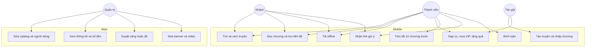
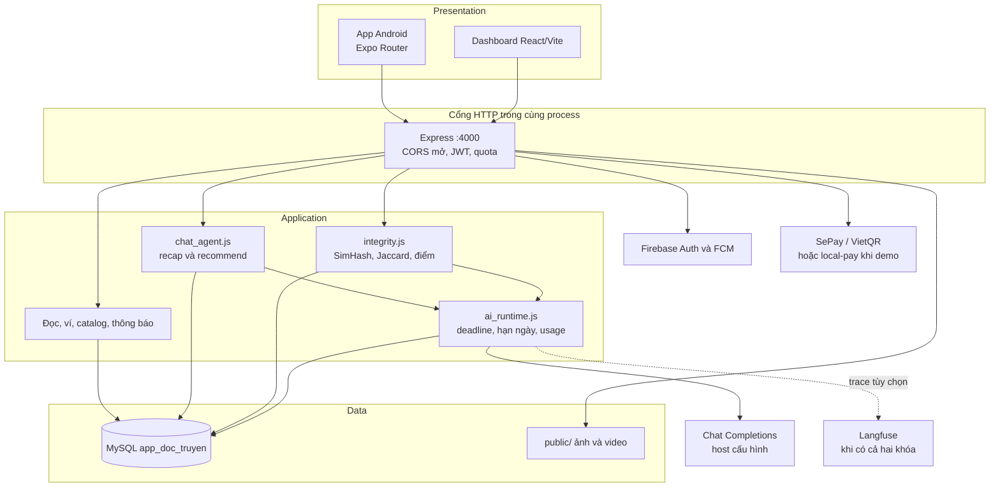
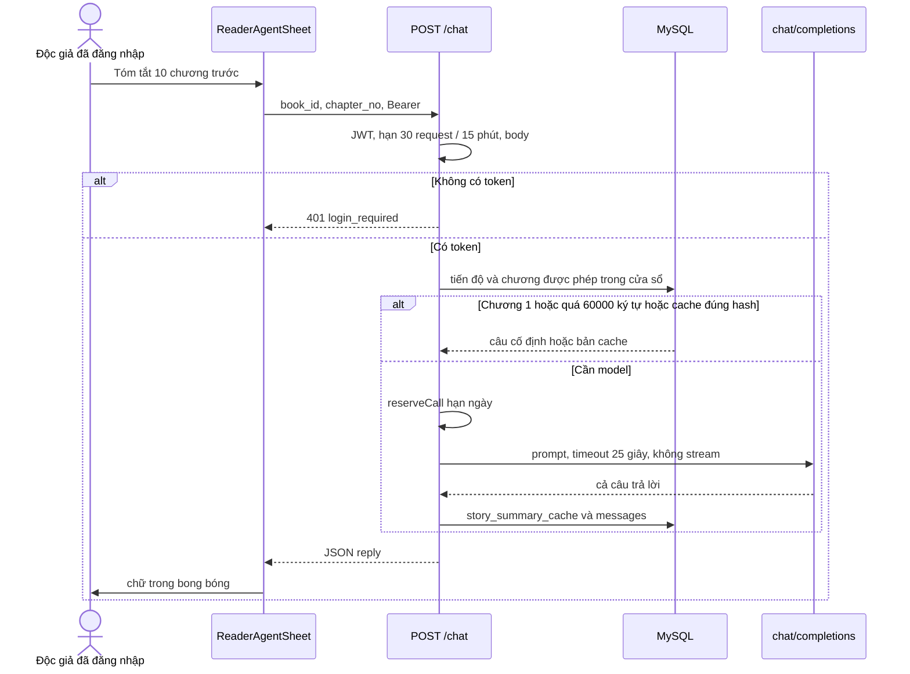
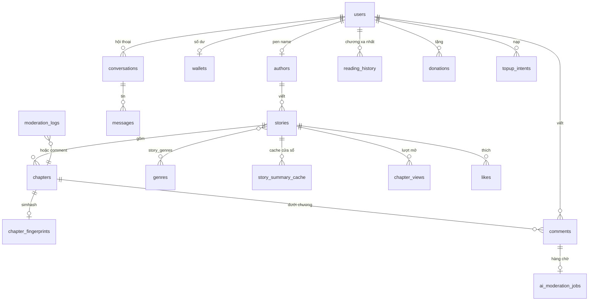

# Báo cáo đồ án Reader App

**Sản phẩm:** Reader App 1.0.0 — hệ thống đọc truyện chữ tiếng Việt, gồm ứng dụng di động và cổng vận hành web  
**Ngày lập:** 06/10/2026  
**Căn cứ:** mã đang có trong cây làm việc ngày 06/10/2026 (`src/`, `admin-dashboard/server/`, `admin-dashboard/frontend/`, `schema.sql`, `app.json`, `eas.json`, `.github/workflows/ci.yml`). Số liệu kiểm thử lấy từ biên bản đã lưu trong `docs/ai-audit/` ngày 01–02/10/2026. Ngày 06/10 không chạy lại benchmark. Hạng mục chưa đo không được điền số ước lượng.

Báo cáo bám sườn sáu chương của hội đồng. Những kỹ thuật có trong sườn nhưng không có trong mã (RAG, embedding, vector database, fine-tuning, BLEU/ROUGE, SSE, Docker, Nginx, hàng đợi Celery/RabbitMQ) được trình bày như lý thuyết đối chiếu, rồi ghi quyết định thực tế của đề tài. Không có vai giáo viên. Web là cổng của quản trị viên.

---

## Chương 1. Tổng quan và bài toán nghiên cứu

### 1.1. Đặt vấn đề và tính cấp thiết

Độc giả truyện chữ tiếng Việt hiện dùng các ứng dụng tổng hợp: catalog lớn, đọc nhanh, có mục lục và bình luận. Nhóm sản phẩm đó giải bài toán phân phối nội dung, nhưng để lại năm việc mà một đồ án tự host phải làm lại nếu muốn kiểm soát dữ liệu, tiền và nội dung cộng đồng:

1. **Mất mạch đọc.** Người đọc mở nhiều truyện, quay lại chương cũ để đối chiếu, rồi bị bookmark kéo về chương vừa thoát. Hệ thống này lấy mốc “Đọc tiếp” theo số chương cao nhất đã từng mở, gồm cả `chapter_views`. `progress_pct` chỉ là vị trí cuộn bên trong chương xa nhất đó.
2. **Đọc phụ thuộc mạng.** Chương dài trên mạng di động hay đứt. Ứng dụng ghi chương ra tệp JSON trong vùng lưu trữ của app và mở tệp đó trước khi gọi API.
3. **Quên cốt truyện mà vẫn sợ bị spoil.** Tóm tắt cả bộ, hoặc tóm tắt bằng truy xuất ngữ nghĩa trên mọi chương, dễ kéo tình tiết chưa đọc vào câu trả lời. Trợ lý chỉ tóm tắt cửa sổ tối đa 10 chương **trước** vị trí đã xác minh.
4. **Chọn truyện tiếp theo trên catalog nhỏ.** Tìm `LIKE` theo tên không diễn tả “cùng thể loại / cùng không khí”. Trợ lý hỏi lại khi thiếu mốc, rồi chỉ trả về mã truyện có thật trong MySQL.
5. **Một người vận hành không đọc hết bình luận và chương mới.** Bình luận có thể là quảng cáo hoặc xúc phạm. Chương mới có thể chép nguyên văn. Pipeline kiểm duyệt chấm và đối chiếu, quản trị viên quyết định ca vàng và ca đỏ.

Khoảng trống mà đồ án lấp là một hệ thống tự host đủ năm vai khách, thành viên, VIP, tác giả và quản trị viên, có đọc offline, xu, VIP, quảng cáo, quà tặng, CMS và hai tác vụ AI (bạn đọc và kiểm duyệt). Repo không có khảo sát quy mô thị trường, nên báo cáo không nêu thị phần hay doanh thu ngành.

### 1.2. Mục tiêu đề tài

**Mục tiêu 1 — Hệ sinh thái hai bề mặt trên một nguồn dữ liệu**

| Bề mặt | Ai dùng | Việc đã làm trong mã |
|---|---|---|
| Ứng dụng Android (Expo / React Native) | Khách, thành viên, VIP, tác giả | Tìm, đọc, tải offline, ví, quà, thông báo, trợ lý đọc |
| Cổng web (React / Vite) | Quản trị viên | Catalog, người dùng, tiền, banner, quảng cáo, bình luận, hàng chờ kiểm duyệt |
| API Express một tiến trình | Cả hai client | REST JSON, MySQL `app_doc_truyen` |

Hai client không có kho trạng thái riêng. MySQL là nguồn sự thật khi `USE_MYSQL=true`.

**Mục tiêu 2 — AI giải bốn việc cụ thể, không phải chatbot tổng quát**

| Việc | Đầu vào | Đầu ra kiểm soát được |
|---|---|---|
| Tóm tắt mạch truyện | Tối đa 10 chương đã được phép đọc, đứng trước chương hiện tại | 3–5 gạch đầu dòng; từ chối chương hiện tại và chương sau |
| Gợi ý truyện | Câu người dùng, tiến độ, kết quả FULLTEXT | Tối đa 4 thẻ, mỗi thẻ là `story_id` có trong catalog |
| Chấm bình luận | Bình luận tối đa 2.000 ký tự | Điểm 0–1, rồi vùng xanh / vàng / đỏ |
| Đối chiếu chương | Chương 1–80.000 ký tự | Vùng xanh xuất bản; vàng và đỏ chờ quản trị viên |

Đề tài xây pipeline quanh bốn việc đó: chọn lát dữ liệu, gọi API chat tương thích OpenAI, kiểm tra đầu ra, cache, hạn mức và đường lui. Đề tài không huấn luyện mô hình và không tự host trọng số.

**Mục tiêu vận hành đã mã hóa**

| Bước | Điều kiện trong mã | Hệ quả |
|---|---|---|
| Khách → tài khoản | Đăng ký email hoặc Google/Facebook | Trần ngày tăng từ `GUEST_DAILY_LIMIT` (mặc định 3 chương) lên 10 chương/ngày với `role=user` |
| Thành viên → VIP | Giá mặc định 500 xu (`VIP_COST_COINS`) | `updateUserVip` cộng 1 tháng. Hết `vip_until`, `refreshUserVipStatus` hạ role `vip` về `user` |
| Thành viên → tác giả | 800 xu, hoặc 300 xu nếu còn ít nhất 15 ngày VIP | Ghi role `author`, cộng 1 tháng `vip_until`, mở truyện đang ẩn. Hết hạn không thu role `author` |
| Chương khóa | `free_chapters` mặc định 3 | Khách và thành viên thường nhận 403 `chapter_locked` |
| Quảng cáo video | `shouldShowAds` | Ẩn với admin, author, VIP chưa có ngày, và mọi role khi `vip_until` còn ở tương lai |
| Nạp xu | 1 xu = 100 VND, mã hết hạn 15 phút | Cộng ví đúng một lần; thiếu tiền hoặc hết hạn không cộng |
| Quà | Hoa hồng 10, trà sữa 50, sư tử 100, tên lửa 200, vương miện 500 xu; số lượng 1–20 | Client chỉ gửi `gift_code` và `quantity` |

Các mục tiêu trên là hành vi trong mã. Repo chưa có chỉ tiêu doanh thu, tỷ lệ chuyển đổi hay SLA.

### 1.3. Đối tượng và phạm vi nghiên cứu

**Đối tượng**

- **Mai, độc giả di động.** Mở app, đọc tiếp đúng chương xa nhất, vẫn đọc khi mất mạng, không bị buộc đăng nhập ngay. Splash khoảng 5 giây rồi vào `/home`. Tiến độ khách nằm ở AsyncStorage khóa `reader_app_reading:guest`. Đăng nhập email hoặc Firebase gọi `hydrateReadingProgress`: gộp map khách vào `reader_app_reading:u:{userId}`, xóa khóa khách, đẩy `POST /progress`, rồi gộp lịch sử server theo chương xa nhất.
- **Huy, độc giả trả phí.** Nạp xu bằng VietQR/SePay, mua VIP một tháng, bớt video quảng cáo khi hạn còn. App hỏi trạng thái nạp mỗi 3 giây. Web không có màn nạp xu cho độc giả.
- **Lan, tác giả nghiệp dư.** Mua quyền đăng, tạo truyện và nhập chương trên mobile. Chương mới vào `pending_review`, `reviewChapter` cho xuất bản nếu vùng xanh. Dashboard có CMS để vận hành, không thay app tác giả.
- **Quản trị viên.** Ngồi trên dashboard `http://localhost:5173`, API `http://localhost:4000`. JWT lưu `localStorage` khóa `admin_token`. Việc gồm thống kê, sửa nội dung, người dùng, sổ giao dịch, banner, video và hàng chờ kiểm duyệt.

Không có persona giáo viên và không có lớp học, bài tập hay điểm số.

**Trong phạm vi đã có mã**

- Xác thực email (bcrypt) và Google/Facebook qua Firebase, backend cấp JWT riêng hạn 30 ngày.
- Catalog, tìm kiếm, thể loại, xếp hạng theo `chapter_views` và `likes`. Cột `stories.views` là số nhập cũ, không phải số hạng trong app.
- Trình đọc, thư viện, tiến độ, tải offline, thích, theo dõi tác giả, bình luận, thông báo trong app, FCM trên Android.
- Ví, VIP, quyền tác giả, SePay/VietQR, quà, quảng cáo video, banner.
- Tác giả tạo truyện và nhập txt/docx.
- Dashboard: tổng quan, sách, chương, thể loại, banner, quảng cáo, người dùng, giao dịch, bình luận, kiểm duyệt AI.
- Bốn tác vụ AI ở mục 1.2.

**Ngoài phạm vi, để hội đồng không hỏi lan**

- RAG, embedding, vector database, fine-tuning, mô hình tự host, GPU.
- WebSocket, SSE, hàng đợi ngoài process, Redis, API gateway tách riêng, Docker, Nginx, chứng chỉ TLS trong repo.
- OCR, định vị, sinh trắc, audiobook, diễn đàn, chợ truyện, thanh toán cửa hàng ứng dụng.
- Cổng đọc truyện trên web ở mức đã nghiệm thu. Expo có target web và một lần export đã build; đó không phải sản phẩm đọc trên trình duyệt đã nhận.
- App Store / TestFlight. EAS production tạo Android App Bundle; khối submit để trống.
- Bảng quyền chi tiết từng hành động. Hiện có bốn role: `user`, `vip`, `author`, `admin`.
- Màn riêng cho đơn xin làm tác giả và lệnh rút xu. API có bảng, sidebar chưa có mục.
- Số đo tải, crash rate, First Contentful Paint, USAT/NPS, BLEU, ROUGE, Time to First Token.

### 1.4. Cấu trúc các chương sau

- **Chương 2** đối chiếu lý thuyết LLM, RAG, agent và các chỉ số đo với kỹ thuật mà mã đang dùng, rồi chốt công nghệ mobile, web, API và cơ sở dữ liệu.
- **Chương 3** mô hình hóa use case, phân vai hai nền tảng, kiến trúc phân tầng, sequence luồng AI và lược đồ MySQL. Không có schema vector.
- **Chương 4** đi vào pipeline tóm tắt, gợi ý, chấm bình luận và đối chiếu chương, đường lui khi model lỗi, các màn hình chính, cách hai client nhìn cùng một dòng MySQL, và môi trường chạy thử.
- **Chương 5** liệt kê ca kiểm thử đã có trong repo và chỉ giữ những số đã ghi. Chỗ chưa đo được ghi là chưa đo.
- **Chương 6** đối mục tiêu chương 1 với phần đã chạy được, nêu hạn chế hạ tầng và ngữ cảnh AI, rồi xếp việc làm sau.
- **Phần câu hỏi hội đồng** trả lời sẵn bốn nhóm câu hay bị xoáy: vì sao việc nằm ở app hay web, đồng bộ song song, pipeline AI tự viết hay chỉ gọi API, và 100 request AI cùng lúc.

---

## Chương 2. Cơ sở lý thuyết và công nghệ áp dụng

### 2.1. Bài toán AI của đề tài

Đề tài không giải bài toán sinh văn tự do. Bốn đầu ra đều có ràng buộc kiểm tra được bằng mã: vùng điểm, mã truyện có thật, hoặc một đoạn tóm tắt bám một lát chương đã cho phép.

#### 2.1.1. Mô hình ngôn ngữ và workflow có công cụ

Một mô hình ngôn ngữ lớn nhận chuỗi tin nhắn và sinh chuỗi tiếp theo. Đề tài không nhúng trọng số. `chatCompletion` trong `admin-dashboard/server/chat_agent.js` gửi `POST {AI_API_BASE}/chat/completions`, body gồm `model`, `messages`, `temperature`, `max_tokens` và, khi cần, `tools`.

Hai kiểu điều khiển khác nhau:

- **Nhánh cố định.** Tóm tắt và kiểm duyệt không để model chọn công cụ. Server đã chọn đúng lát dữ liệu rồi mới gọi.
- **Vòng công cụ (agentic workflow hẹp).** Gợi ý truyện cho model tối đa 3 vòng (`AI_RECOMMEND_MAX_ROUNDS`, trần code 4). Mỗi vòng tối đa 3 lời gọi. Công cụ agent được thấy chỉ có ba tên: `get_user_progress`, `search_stories`, `save_to_favorites`. `get_catchup_summary` là hàm nội bộ, không nằm trong danh sách công cụ.

Đây là workflow có luật, không phải framework agent đa mục tiêu. Model không được tự duyệt chương, không được tự cộng xu, không được kết luận bản quyền.

Cấu hình model:

- Thiếu biến môi trường thì base mặc định là `https://api.x.ai/v1`, model `grok-4.5`.
- Host `api.x.ai` nhận khóa theo thứ tự `XAI_API_KEY`, `GROK_API_KEY`, `AI_API_KEY`.
- Mọi host khác chỉ nhận `AI_API_KEY`, để khóa Grok không bị gửi sang gateway khác.
- Chuỗi `YOUR_API_KEY`, `changeme`, `replace_me` bị bỏ.
- Model theo việc: `AI_CHAT_MODEL`, `AI_RECAP_MODEL`, `AI_MODERATION_MODEL`, `AI_PLAGIARISM_MODEL`, không có thì dùng `AI_MODEL`.
- Lần đo ngày 02/10 dùng base `https://api.xah.io/v1` và model cấu hình `ngovutuananh/gpt-5.5-xhigh`. Đó là cấu hình của lần đo.

#### 2.1.2. RAG, embedding và fine-tuning — lý thuyết và quyết định của đề tài

**RAG** (Retrieval-Augmented Generation) cắt tài liệu thành đoạn, embed thành vector, tìm đoạn gần câu hỏi, rồi nhét các đoạn đó vào prompt. **Fine-tuning** cập nhật trọng số trên tập ví dụ riêng. Cả hai đều có chỗ đứng khi câu hỏi mở trên kho lớn hoặc khi cần giọng văn cố định.

Đề tài không dùng ba kỹ thuật đó. Lý do gắn với từng việc:

- Tóm tắt cần **đúng thứ tự chương đã đọc**, không cần đoạn “giống nghĩa” ở chương 80 khi người đọc đang ở chương 12. Cửa sổ `RECAP_WINDOW = 10` cố định thứ tự và chặn spoil. Embedding chương chưa đọc sẽ phá ràng buộc này.
- Gợi ý chạy trên catalog nhỏ. `search_stories` dùng `MATCH(title, description) AGAINST (… IN NATURAL LANGUAGE MODE)`. `LIKE` chỉ khi `MATCH` lỗi. Ghi chú thiết kế trong repo dành embedding tên–mô tả–thể loại cho lúc catalog khoảng vài trăm truyện và FULLTEXT bỏ sót câu “cùng không khí”. Khi đó cũng không embed toàn văn chương.
- Đối chiếu chương cần bắt **chép nguyên văn và chép gần nguyên văn**. SimHash 64-bit tìm ứng viên; Jaccard trên cụm 5 từ đo phần chữ trùng. Embedding bắt cùng chủ đề và bỏ sót bản chép từng câu.
- Fine-tuning cần tập nhãn, máy huấn luyện và một vòng đánh giá lặp. Repo không có tập đó và không có GPU.

Vì vậy chương 4 mô tả pipeline lát chương, FULLTEXT, SimHash và prompt có kiểm tra đầu ra. Không có bước chunking cho vector, không có mô hình embedding, không có Qdrant, Pinecone hay Chroma.

#### 2.1.3. Dữ liệu đưa vào prompt, và hàng rào trước khi hiện cho người dùng

**Lát dữ liệu, không phải vector search**

| Việc | Lát đưa vào model | Trần |
|---|---|---|
| Tóm tắt | Toàn văn chương từ `max(1, n-10)` đến `n-1`, chỉ chương người đó được đọc | `AI_RECAP_MAX_CHARS` mặc định 60.000, trần 85.000 |
| Gợi ý | Kết quả công cụ, tối đa 8 truyện, không nhét cả catalog | `AI_RECOMMEND_MAX_TOKENS` mặc định 240, trần 700 |
| Bình luận | Nội dung bình luận và rubric tiếng Việt | 2.000 ký tự ở intake; `max_tokens` 64 |
| Đối chiếu | Các đoạn đã khớp, không phải 1.000 ký tự đầu | `max_tokens` 250; chỉ gọi khi đã có bằng chứng chữ |

Prompt tóm tắt gắn nhãn văn truyện là dữ liệu, cấm làm theo chỉ dẫn nằm trong truyện, cấm bịa sự kiện ngoài nguồn, cấm nhắc chương hiện tại trở đi. Prompt độc hại yêu cầu JSON `{"score": số từ 0 đến 1}` và phân biệt phê bình tác phẩm với công kích người. Prompt đối chiếu chỉ được mô tả chỗ giống và khác, cấm kết luận “đạo văn” và cấm đề xuất khóa.

**Hàng rào sau khi model trả lời**

- Parser điểm chỉ nhận số hữu hạn trong [0, 1]. Văn xuôi, số năm, phần trăm hay chuỗi đều bị loại.
- `finish_reason=length` làm bản ghi bị coi là cắt cụt, không dùng làm điểm hay câu trả lời.
- Gợi ý chỉ giữ `story_id` có trong catalog. ID bịa bị bỏ.
- Vùng xanh bình luận (`score < 0,5`) mới `approved`. Từ 0,5 đến 0,8 là `shadowbanned` và có dòng trong hàng chờ. Trên 0,8 giữ `pending` kèm log toxicity.
- Điểm hỏng, timeout, hết khóa: heuristic và **giữ để người duyệt**. Heuristic khoảng 0,92 với tục nặng có dấu, 0,78 với cụm kiểu “đồ ngu”, 0,08 với câu thường. Từ “các / lớn / buổi” không bị bỏ dấu rồi kết án.
- Vùng chương do Jaccard và Hamming quyết định. Model không đổi vùng.
- Thiếu API key ở nhánh gợi ý không gọi mạng: server trả vài thẻ trong thư viện và ghi `fallback_reason=ai_unconfigured`. Nhánh tóm tắt trả câu cố định, không ghi cache. Mã 500 `AI service not configured` vẫn có trong `handleChatRequest` khi lỗi `ai_unconfigured` được ném ra, nhưng hai nhánh trên nuốt lỗi đó thành câu dự phòng.

Các hàng rào này giảm câu trả lời hỏng và ID bịa. Chúng không chứng minh mọi câu tóm tắt đều hết sự kiện bịa. Repo chưa có bộ chấm sự kiện trên tập giữ lại.

#### 2.1.4. Chỉ số đo — chỉ số nào hợp với bài toán này

| Chỉ số trong sườn hội đồng | Có dùng để chấm đề tài này không | Cách hiểu |
|---|---|---|
| BLEU, ROUGE | Không tính | Hai chỉ số so n-gram với câu tham chiếu. Đầu ra ở đây là vùng xanh/vàng/đỏ, mã truyện, hoặc đoạn tóm tắt không có đáp án chuẩn |
| Precision / Recall | Có trên bộ mẫu tự viết, theo vùng kỳ vọng | 50/50 mẫu ngày 02/10 khớp vùng đã gán trước. Không ngoại suy ra mọi câu tiếng Việt |
| Latency cả phản hồi | Có vài mốc đã ghi | Deadline mặc định 25 giây. Có ca 17,126 giây thành công và ca quá 25 giây bị hủy. Không có p50/p95 |
| Time to First Token | Không đo | API không stream. Client nhận cả JSON khi model đã sinh xong |
| Token và tiền | Có cho lần đo 02/10 | 65 request upstream, 2.134,08 VND đã xác nhận. Không có hóa đơn tháng |
| Điểm sẵn sàng 4,2/10 | Chỉ là mốc trước khi sửa, ngày 01/10 | Không phải điểm của mã ngày 06/10. Chưa chấm lại cùng thang |

### 2.2. Công nghệ nền tảng

**Mobile.** React Native 0.81.5, React 19.1.0, Expo SDK 54, Expo Router 6, TypeScript 5.9. Gói Android , `minSdk` 24, màn hình dọc, `newArchEnabled` bật. Entry là `expo-router/entry`, cây màn hình ở `src/app`.

Lý do chọn React Native và Expo: một codebase TypeScript cho Android, có dev client để gắn Firebase, Facebook SDK, FCM và module rung. Flutter không có trong repo. iOS được khai báo `supportsTablet` nhưng `eas.json` chưa có hồ sơ build iOS.

State không dùng Redux hay Zustand. `AppTheme` là React context: cỡ chữ mặc định 18, kẹp 14–28; giãn dòng 1,6 / 1,75 / 2, mặc định 1,75. Phiên nằm ở SecureStore trên máy và `localStorage` trên web. Tiến độ đọc nằm ở AsyncStorage.

**Web vận hành.** React 18.2.0, Vite 5, Chart.js 4, render phía client. Điều hướng là hash trên một sidebar (`#dashboard`, `#books`, …), không phải Expo Router. Dev server cổng 5173.

**Backend.** Node.js, Express 4.18, JavaScript thuần. Một file route lớn `admin-dashboard/server/index.js`, logic tách ở `mysql.js`, `chat_agent.js`, `integrity.js`, `ai_runtime.js`, `ai_store.js`, `gifts.js`, `push.js`, `firebase_auth.js`, `langfuse.js`. Pool MySQL `connectionLimit` 10.

**Cơ sở dữ liệu.** MySQL 8, `mysql2`, `utf8mb4`, InnoDB, database khai báo `app_doc_truyen`. Cache tóm tắt là bảng `story_summary_cache`. Hạn mức AI là bảng `ai_request_quotas`. Job kiểm duyệt là bảng `ai_moderation_jobs`. Không có Redis. `data.json` chỉ là lối lui cho một phần catalog khi tắt MySQL. Auth, ví, bình luận, quảng cáo, tìm kiếm và AI yêu cầu MySQL.

**Tệp.** `multer` ghi ảnh bìa, banner và video vào `admin-dashboard/server/public`. Chưa có object storage.

### 2.3. Giao thức

Mọi client nói REST JSON qua HTTP. Không có GraphQL. Không có WebSocket nghiệp vụ. Không có SSE: `chatCompletion` đợi `res.json()` rồi mới trả app. Trong lúc chờ, sheet hiện ba chấm trong bong bóng.

Ba nhịp gần thời gian thực vẫn là REST:

- App hỏi trạng thái nạp xu mỗi 3 giây cho đến khi intent được cộng hoặc hết hạn.
- Worker bình luận thức mỗi 1 giây, lấy một job.
- FCM đẩy thông báo tới máy Android đã đăng ký token. Kênh này không đồng bộ ví hay tiến độ đọc.

JWT đi trong header `Authorization: Bearer`. Webhook SePay dùng `Authorization: Apikey`.

---

## Chương 3. Phân tích và thiết kế hệ thống

### 3.1. Use case

Phân rã ba use case dễ bị hỏi chi tiết:

- **Đọc chương.** Kiểm tra đăng nhập tùy chọn, role, `free_chapters`, trần ngày, trạng thái `published`. Ghi `chapter_views` và `reading_history`. Ưu tiên tệp offline nếu có nội dung.
- **Tóm tắt.** Bắt buộc đăng nhập. Từ chối trước khi tạo hội thoại nếu không có token. Kẹp `chapter_no` theo tiến độ đã xác minh. Chương 1 không gọi model.
- **Nhập chương.** Tác giả gửi nội dung. Bản ghi tạo ở `pending_review`. `reviewChapter` đối chiếu rồi hoặc `published` hoặc giữ chờ. Tác giả và admin đọc được chương chưa xuất bản; người khác nhận 403.

### 3.2. Phân vai hai nền tảng

| Việc | App | Web | Lý do việc nằm ở bề mặt đó |
|---|---|---|---|
| Đọc dọc, cỡ chữ, giãn dòng, theme ngày/đêm/OLED | Có | Không | Thao tác một tay, session dài, giữ màn hình sáng |
| Tải chương khi mất mạng | Có | Không | File nằm trong vùng app |
| Thông báo đẩy | Có, Android | Không | Cần FCM và quyền `POST_NOTIFICATIONS` |
| Trợ lý đọc ngay tại chương đang mở | Có, sheet | Không | Cần `book_id` và `chapter_no` của trang đọc |
| Nạp QR, ví, quà | Có | Sổ giao dịch và cộng xu tay | Độc giả đang ở trên điện thoại; admin đối soát trên bảng |
| Tạo truyện, nhập txt/docx | Có | CMS sửa chương | Tác giả viết trên máy của họ; admin sửa khi vận hành |
| Hàng chờ kiểm duyệt, Diff hai cột, trace | Không | Có | Đối chiếu văn bản dài, quyết định khóa hoặc xuất bản |
| Top truyện, người dùng mới, thu VND | Không | Có | Biểu đồ Chart.js, không phải việc của độc giả |

Cùng một việc không được làm hai lần. Dashboard không phải app đọc. App không mở hàng chờ kiểm duyệt.

### 3.3. Kiến trúc phân tầng

Hệ thống là một tiến trình Node. Không có API gateway riêng và không có service AI riêng. Worker kiểm duyệt nằm trong process đó.

Ánh xạ sang tên lớp trong sườn hội đồng:

| Lớp trong sườn | Trong repo |
|---|---|
| Presentation | `src/app`, `admin-dashboard/frontend` |
| API Gateway | Không có gateway riêng. Express trên cổng 4000 làm luôn việc này |
| Application | Route trong `index.js` và các module nghiệp vụ |
| AI Processing Engine | `chat_agent.js`, `integrity.js`, `ai_runtime.js` cộng HTTP tới nhà cung cấp |
| Data | MySQL, đĩa `public/`, SecureStore và AsyncStorage trên máy |

### 3.4. Sequence luồng tóm tắt

Luồng gợi ý thêm vòng công cụ trước bước sinh JSON. Luồng bình luận khác ở chỗ app chỉ `INSERT` trạng thái `pending`; worker 1 giây sau mới gọi model, nên người viết không chờ GPU trên request HTTP của chính họ.

Luồng nạp xu: `POST /wallet/topup-intent` tạo mã `RD…` hạn 15 phút. App hỏi mỗi 3 giây. `POST /sepay/webhook` hoặc `POST /wallet/verify-payment` gọi `consumeAndCreditIntent` đúng một lần. Khi không ở production, `POST /sepay/local-pay` cộng xu để demo.

### 3.5. Lược đồ thực thể quan hệ

Nhóm bảng chính. Khóa và vài cột then chốt nằm ở `admin-dashboard/server/schema.sql`.

`reading_history` một dòng cho mỗi cặp user và truyện. `chapter_no` là chương xa nhất đã lưu. `progress_pct` là phần trăm cuộn trong chương đó, không phải phần trăm cả bộ. `chapter_views` là từng lần mở chương và là nguồn để nâng mốc “Đọc tiếp” khi lịch sử đang thấp hơn.

`stories.cover_image` được API đặt bí danh `cover_url`. Không có cột `cover_url`.

### 3.6. Phần lưu trữ phục vụ tìm và kiểm duyệt

Sườn hội đồng hỏi schema vector. Đề tài không có bảng vector. Phần tương ứng là bốn cấu trúc sau.

| Cấu trúc | Khóa | Nội dung | Việc AI dùng |
|---|---|---|---|
| `FULLTEXT ft_story_search` | `stories(title, description)` | Chỉ mục từ MySQL | `search_stories` |
| `story_summary_cache` | duy nhất `(story_id, from_chapter, to_chapter)` | `summary_text`, `source_hash` CHAR(64) | Bỏ qua model khi hash nguồn, model và phiên bản prompt `recap-v2-full-10` còn khớp |
| `chapter_fingerprints.simhash_64` | `BIGINT UNSIGNED`, đọc thành chuỗi thập phân | Vân tay 64 bit | Lấy tối đa 8 chương đã xuất bản gần nhất theo Hamming |
| `moderation_logs` | `target_type`, `target_id`, `status` | `evidence_data` JSON, `trace_id` | Hàng chờ admin, không phải kho embed |
| `ai_usage_logs` | theo thời gian và user | model, latency, token, mã lỗi | Quan sát, không tham gia sinh câu |
| `ai_request_quotas` | `bucket_key` | số hit và `expires_at` | Hạn request |
| `ai_moderation_jobs` | `comment_id` | hash nội dung, lease 120 giây, số lần thử | Job bền, sống qua restart |
| `messages` | `conversation_id`, `created_at` | nội dung, `metadata` JSON, `trace_id` | Lịch sử chat của đúng chủ |

`chapter_recaps` là cache chatbot cũ, không còn được ghi. Bảng `plagiarism_checks` không được `schema.sql` tạo cho luồng agent hiện tại.

---

## Chương 4. Hiện thực hóa và triển khai

### 4.1. Pipeline phân hệ AI

#### 4.1.1. Tóm tắt — lát chương, không chunking

1. `detectIntent` nhận `intent` client gửi hoặc từ khóa tiếng Việt. Có `book_id` mà câu rỗng thì coi là tóm tắt.
2. `handleChatRequest` trả 401 nếu chưa đăng nhập, trước khi tạo hội thoại, đọc chương hoặc gọi model.
3. `chapter_no` client bị kẹp bởi tiến độ đã xác minh. Xin chương hiện tại hoặc chương sau thì từ chối vì spoil.
4. `catchUpWindow` lấy `[max(1, n-10), n-1]`. Chương 1 trả câu “chưa có sự kiện trước” và không gọi model.
5. `getChaptersInRange` chỉ lấy chương người đó được đọc.
6. Hash SHA-256 gồm phiên bản prompt, tên model và nội dung từng chương. Trúng cache thì trả ngay.
7. Hai request cùng cửa sổ trên cùng process đi chung một promise (`summaryFlights`). Nếu `db.withSummaryLock` có mặt thì còn khóa theo `storyId:chapter`.
8. Vượt trần ký tự thì trả câu từ chối, không gọi model, không ghi cache.
9. Gọi model `temperature` 0,2, `max_tokens` 380. Thành công thì ghi cache. Thất bại thì câu “Chưa tạo được bản tóm tắt đáng tin cậy”, không ghi cache.

Không có chiến lược chunk 512 token, không có overlap, không có mô hình embedding. Điểm yếu đã biết: một chương rất dài làm cả cửa sổ chạm 60.000 ký tự và bị từ chối. Bản tóm tắt cuốn chiếu các chương cũ chưa được viết.

#### 4.1.2. Gợi ý — truy xuất từ khóa rồi mới sinh

1. Khách cũng gọi được.
2. `recommendationClarification` hỏi lại khi thiếu thể loại, tâm trạng, tên hoặc mốc đang đọc. “Gì cũng được” sau câu hỏi đó thì đi tiếp. “Cùng vibe” đủ khi đã có `book_id` hoặc tiến độ.
3. `search_stories` chạy FULLTEXT, tối đa 8 truyện không ẩn. `GET /books/search` là tìm thường của màn tìm kiếm, tách khỏi công cụ này.
4. `get_user_progress` đọc tối đa 12 dòng `reading_history`.
5. `save_to_favorites` chỉ khi câu người dùng nói rõ muốn lưu, đã đăng nhập, và truyện còn hiện. Like đã ghi được giữ kể cả vòng sau bị timeout.
6. Model phải trả JSON các `story_id`. Server dựng thẻ: `id`, `title`, `genre`, `cover_url`, `chapters_count`, mô tả cắt 180 ký tự. App vẽ tối đa 4 thẻ trong `StoryFlashcards`.
7. Model lỗi, thiếu key, hoặc quá số lệnh gợi ý đang chạy: `catalogFallback` lấy vài truyện khớp từ khóa và câu trả lời nói rõ là phương án dự phòng. Cùng một khóa câu hỏi đi chung một lần gọi. Kết quả đúng được nhớ trong process 5 phút (`AI_RECOMMEND_CACHE_TTL_MS` mặc định 300.000). Lệnh có ý lưu tủ sách không đi vào cache này.

Không có hybrid search (từ khóa cộng vector) và không có bước re-rank bằng model cross-encoder. Thứ hạng là thứ FULLTEXT trả về, rồi model chọn ID trong tập đó.

#### 4.1.3. Bình luận

1. `intakeComment`: rỗng thì 400, dài hơn 2.000 ký tự thì 413, mẫu quảng cáo cờ bạc thì 400. Thảo luận truyện có chữ casino đơn lẻ không bị chặn cứng.
2. Bản ghi tạo ở `pending`. `enqueueCommentModeration` ghi job kèm hash nội dung.
3. `startCommentWorker` mỗi 1 giây. `workerBusy` bảo đảm một job tại một thời điểm trên process. Lease 120 giây. Job kẹt được nhận lại. Tối đa 3 lần thử, lần sau cách 15 giây nhân số lần.
4. Sai hash thì bỏ job, không chấm bản đã bị sửa.
5. Model `temperature` 0. Parser nhận JSON. Áp vùng như mục 2.1.3.
6. Vàng và đỏ đều có `moderation_logs`. Admin bấm “Cho xuất bản” ghi `approved_by_admin`. “Khóa” ghi `penalized_by_admin`.

#### 4.1.4. Chương mới

1. `POST /books/:id/chapters` nhận 1–80.000 ký tự. Trạng thái tạo là `pending_review`.
2. `simhash64` băm unigram và bigram bằng FNV-64, cộng trừ theo từng bit.
3. Lấy tối đa 8 vân tay gần nhất trong các chương đã xuất bản. Khoảng cách bit một mình không thành vùng.
4. Với mỗi ứng viên, tính Jaccard trên cụm 5 từ của toàn văn và rút các đoạn trùng.
5. Không có đoạn trùng thì xanh, `published`. Trùng khít, hoặc Hamming không quá 3 và Jaccard từ 0,8 trở lên, thì đỏ. Mọi ca còn bằng chứng chữ thì vàng. Vàng và đỏ giữ `pending_review`.
6. Chỉ ca không xanh mới gọi model để viết nhận xét cho admin. Nhận xét không đổi vùng.
7. Lỗi đối chiếu không tự xuất bản.

`simhash_64` lưu `BIGINT UNSIGNED` dạng chuỗi vì vượt số nguyên an toàn của JavaScript.

### 4.2. Ngoại lệ, timeout và đường lui

| Sự cố | Hành vi trong mã |
|---|---|
| Hết 25 giây (`AI_TIMEOUT_MS`, trần helper 60 giây) | `AbortSignal` hủy fetch, lỗi `ai_timeout` |
| HTTP lỗi, body rỗng, output cắt cụt | `ai_request_failed`, `ai_empty_response`, `ai_truncated` |
| Hết hạn ngày | `reserveCall`: 100 lượt/user (`AI_USER_DAILY_CALL_LIMIT`) và 1.000 lượt toàn hệ thống (`AI_DAILY_CALL_LIMIT`) |
| Hết hạn cửa sổ | `enforceAiQuota`: chat 30, comment 30, duplicate 10, import sách 2, trên 15 phút, theo user và theo IP. User đăng nhập có trần IP bằng 4 lần mức user |
| Gợi ý, model lỗi sau khi đã có key | Danh sách từ khóa trong thư viện, câu chữ ghi là dự phòng |
| Tóm tắt, model lỗi | Câu cố định, không ghi cache |
| Bình luận, model lỗi | Heuristic, giữ `pending`, không tự duyệt |
| Đối chiếu, model lỗi hoặc timeout | Giữ vùng thuật toán và bằng chứng đoạn; admin vẫn thấy hàng chờ |
| Hội thoại gửi lên model quá 100.000 ký tự JSON | Từ chối trước khi gọi mạng. Body HTTP của `/chat` còn bị chặn sớm hơn: câu quá 2.000 ký tự hoặc cả body quá 16.000 ký tự trả 413 |
| Quá 50 lệnh gợi ý chỉ đọc đang chạy (`AI_RECOMMEND_MAX_INFLIGHT`, trần code 200) | Không gọi thêm model; trả thư viện với lý do `ai_busy` |
| Provider gợi ý vừa timeout hoặc HTTP 429/5xx | Nghỉ gọi provider đó 15 giây (`AI_RECOMMEND_FAILURE_TTL_MS`, trần 60 giây), các câu khác trong lúc đó đi fallback |
| Quá 3 bản tóm tắt đang chạy | Thêm tối đa 20 request chờ. Request thứ 24 trở đi nhận 429 `ai_busy`. Khóa MySQL `GET_LOCK` 5 giây, không lấy được thì cũng 429 |
| Hai tóm tắt cùng cửa sổ | Một lần gọi model; process khác chờ cùng `GET_LOCK` |

Hủy ở client không bảo đảm nhà cung cấp ngừng tính tiền. Lần đo 02/10 có 8 request timeout chưa có hóa đơn, nên báo cáo tách “phí đã xác nhận” và “dự phòng”.

Quota là hạn theo số request. `max_tokens` không thành trần tiền nếu gateway tính thêm token suy luận. Ngày 01/10, hai lượt yêu cầu `max_tokens` nhỏ vẫn được gateway báo completion token cao hơn mức xin.

### 4.3. Giao diện đã hiện thực

Repo không lưu bộ ảnh chụp màn hình. Phần dưới là các màn đang có trong mã, để đối chiếu khi chụp lúc bảo vệ. Ảnh chưa được nhúng vào file này.

**App Android**

| Màn | Route | Việc nhìn thấy |
|---|---|---|
| Splash | `/` | Ảnh splash, sau khoảng 5 giây sang home |
| Cổng | `/home` | Vào khám phá, đăng nhập, đăng ký, hoặc tiếp tục như khách |
| Khám phá | `/(tabs)/explore` | 5 truyện mới (`pickHomeRecommendations` trên 50 truyện `sort=recent`), top xem, gợi ý, thể loại. Quảng cáo `home` một lần mỗi phiên |
| Theo dõi | `/(tabs)/follow` | Có token thì `GET /following/feed?limit=30`. Bài cũ hơn 3 ngày bị lọc. Khách thấy feed rỗng |
| Thư viện | `/(tabs)/library` | Đang đọc, Đã thích (trang 20, có cursor), Đã tải. Dòng không có `title` bị bỏ khỏi Đang đọc |
| Xếp hạng | `/(tabs)/rank` | Theo lượt xem hoặc lượt thích trong app |
| Hồ sơ | profile | Số xu, VIP, mua quyền tác giả, QR, đăng xuất |
| Truyện | `/book/:id` | Tóm tắt, chương, bình luận, thích, theo dõi, quà, tải offline, quảng cáo `book-open` |
| Đọc | `/reader/:id` | Cuộn dọc, chương trước/sau, cỡ chữ, theme, sheet trợ lý. Quảng cáo `reader` khi response có `ad_required` và `shouldShowAds` |
| Chatbot | `/chatbot` | Gợi ý hoặc chọn truyện đang đọc rồi đẩy sang trang đọc với cờ recap |
| Tác giả | `/author/create`, `/author/manage` | Tạo, sửa, nhập chương |

Nút bỏ qua quảng cáo khóa tối thiểu 15 giây (`minSecondsToSkip`). Placement lạ, mặc định là `interstitial`, làm component đóng ngay. Theo dõi, Thư viện, Xếp hạng và trang tác giả gắn component nhưng không truyền placement, nên video không phát ở đó.

Offline tách scope `u_{userId}` hoặc `guest`. Chỉ mục `reader_app_offline_index_v1_{scope}` trong SecureStore. File `offline/{scope}/book_{id}.json`. Chương đầu không có nội dung thì lần tải ném lỗi. Chương sau lỗi thì file ghi `partial: true` và dừng. Trình đọc ưu tiên file offline.

Đăng xuất hồ sơ gọi `Auth.logout`: trên Android gỡ token FCM, thoát Google và Firebase, rồi xóa JWT, user và khóa phương thức đăng nhập.

**Dashboard**

| Hash | Việc |
|---|---|
| `#dashboard` | Top truyện tối đa 6 theo lượt xem rồi lượt thích, bỏ truyện ẩn và truyện cả hai số đều 0; người dùng mới, VIP, tác giả, thu nhập VND |
| `#books`, `#chapters`, `#genres` | CMS. Làm mới `#chapters` khi không giữ book id thì mất ngữ cảnh sách |
| `#banners`, `#ads` | Banner không lọc VIP. Form quảng cáo có `home`, `book-open`, `reader`. Giá trị cũ `interstitial` hoặc `banner` hiện nhãn “(cũ)” |
| `#users`, `#transactions`, `#comments` | Role, cộng xu tay, sổ SePay (Tự động), duyệt bình luận |
| `#integrity` | Hàng chờ `pending_review`, Diff hai cột, Cho xuất bản / Khóa, khung Langfuse nếu có khóa |

Không có mục Cài đặt. Không có mục đơn xin tác giả và rút xu.

**Tương thích kích thước.** App khóa dọc. `minSdk` 24. Chưa có biên bản đo trên một ma trận máy (điện thoại nhỏ, máy tính bảng, chữ lớn của hệ điều hành). Export web Expo ngày 02/10 build được; bản đó không thay kiểm thử giao diện native. Bàn phím Android dùng `KeyboardPush` trong layout gốc vì edge-to-edge làm `adjustResize` không thu cửa sổ. Modal phải gắn lớp này riêng.

### 4.4. Đồng bộ giữa web và app

Hai client không mở kênh đẩy trạng thái. Mỗi bên đọc lại REST. Thao tác song song hòa vào MySQL theo từng request, không theo một phiên realtime.

| Dữ liệu | Ai ghi | Người kia thấy lúc nào | Chỗ dễ lệch |
|---|---|---|---|
| Truyện, chương, banner, quảng cáo | Admin hoặc tác giả | Lần `GET` tiếp theo | Màn đang mở không tự nhảy |
| Role và ví | Mua VIP, webhook, admin cộng xu | `GET /me`, `GET /wallet`, hoặc lần đọc chương | Hai máy chỉ khớp sau request mới |
| Tiến độ | `POST /progress` và `chapter_views` | Lần mở thư viện sau khi gộp | Hai máy cùng tài khoản không đẩy cho nhau. Gộp lấy chương cao hơn |
| Bình luận | User gửi `pending` | Vài giây sau khi worker chấm, nếu app tải lại | Vàng chỉ người viết thấy |
| Chương chờ | Tác giả gửi, admin duyệt | Lần mở chi tiết sau | Trước khi duyệt, người đọc thường nhận 403 |
| Nạp xu | Webhook | Trong modal, trễ thêm tối đa một nhịp 3 giây | Đóng modal thì hết vòng hỏi |
| Thông báo chương mới | Server ghi `user_notifications` và FCM | FCM tới máy đã có token | Máy chưa xin quyền thì chỉ còn hộp thông báo trong app |

`upsertProgress` lấy max của chương đang lưu, chương vừa gửi và chương cao nhất trong `chapter_views`. Đọc lại chương sớm hơn không kéo mốc lùi. Đăng nhập gộp tiến độ khách vào khóa user rồi đẩy server. Cache máy vẫn giữ mục local chưa có trên server, để lần sau đẩy tiếp.

Nạp xu dùng `SELECT … FOR UPDATE` trên `topup_intents` trong `consumeAndCreditIntent`, nên hai webhook cùng mã không cộng hai lần. Một số bút toán ví khác (quà, rút) chưa nằm trong một transaction duy nhất. Đó là hạn chế ở chương 6, không phải cơ chế đồng bộ realtime.

### 4.5. Môi trường chạy thử

Repo không có Dockerfile, docker-compose, Nginx, Terraform hay chứng chỉ TLS.

**Máy phát triển**

- `run_server.bat`: API `0.0.0.0:4000`.
- `run_frontend.bat`: Vite 5173.
- `run_mobile.bat` hoặc `npx expo start --dev-client --port 8081`.
- App chọn base URL theo thứ tự: địa chỉ LAN đang cấu hình, `127.0.0.1:4000`, `EXPO_PUBLIC_API_BASE` hoặc `extra.apiBase`, rồi `10.0.2.2:4000` cho emulator.
- Điện thoại thật cần cùng mạng hoặc `adb reverse`. Expo Go không chạy đăng nhập Google/Facebook vì thiếu native module. Cần dev client.
- Ảnh và video nằm trên đĩa máy chạy API.

**CI.** `.github/workflows/ci.yml` trên push, pull request và khi bấm tay: Node 22, `npm ci` ở ba package, `npm test`, `tsc --noEmit`, `vite build`. CI không bật MySQL, không gọi AI trả phí, không cài Android, không deploy.

**Gói cài.** EAS development và preview ra APK nội bộ, API base là HTTP LAN. Production ra Android App Bundle và không ghi API base trong profile. Khối submit để trống.

Trước khi mở ra ngoài LAN cần URL HTTPS ổn định, CORS thu lại, secret JWT và webhook khác giá trị mẫu, tắt `ALLOW_DEV_TOKENS`, tắt `SEPAY_LOCAL`, và một URL công khai cho webhook. SePay không gọi được `localhost`. Production (`NODE_ENV=production`) thoát ngay nếu `JWT_SECRET` trống hoặc còn `dev_secret_change_me`, và nếu thiếu `PAYMENT_WEBHOOK_SECRET`.

**An toàn đã có trong mã, gắn với triển khai**

- Mật khẩu bcrypt cost 10. Sai định dạng trả 400.
- Firebase Admin xác minh ID token trước khi đọc database. Email chỉ liên kết khi đã xác minh.
- Mỗi request đọc lại role từ MySQL. Tài khoản bị xóa nhận 401. Lỗi DB lúc đọc role trả 503.
- Bypass dev chỉ khi đồng thời `ALLOW_DEV_TOKENS=true`, `NODE_ENV=development` và socket thật là loopback.
- Khách mặc định 3 chương khác nhau mỗi ngày theo IP. Thành viên 10 chương/ngày. VIP, tác giả, admin và chủ truyện không trần ngày. `reserveChapterRead` chặn hai request song song vượt hạn.
- Giá VIP, giá tác giả, giá quà và tỷ giá xu nằm ở server.

**Chỗ triển khai còn mở**

- JWT admin trong `localStorage`, hạn 30 ngày, chưa có denylist và chưa có cookie `HttpOnly`. Đổi mật khẩu không vô hiệu JWT còn hạn.
- CORS đang mở.
- API dev là HTTP LAN.
- Một process, không PM2, không cluster trong script.
- Chưa có script backup MySQL trong repo.

---

## Chương 5. Kiểm thử và đánh giá kết quả

Số trong chương này là kết quả đã lưu. Ngày 06/10 không chạy lại suite và không chạy lại provider trả phí.

### 5.1. Ma trận kiểm thử

**Bộ mặc định `npm test` — không cần MySQL và không cần khóa AI**

| Nhóm | File | Số ca | Việc ca này khóa |
|---|---|---:|---|
| Feed trang chủ | `test/homeFeed.test.cjs` | 6 | Đúng 5 truyện, đổi bộ khi làm mới, bỏ truyện đã rời catalog |
| Nhập chương | `test/chapterImport.test.cjs` | 11 | UTF-8, file hỏng, thứ tự tệp, Word, dừng khi lỗi giữa chừng, không nhận nhầm lỗi quyền là thành công |
| Tiến độ | `test/readingProgress.test.cjs` | 5 | Giữ chương xa nhất, tiến bookmark khi mở chương sau, gộp `chapter_views` |
| AI không mạng | `admin-dashboard/server/test/ai.test.js` | 27 | Chương 1 không gọi model, cửa sổ 10 chương, cache theo hash, một lần gọi khi hai miss trùng nhau, khách không được tóm tắt, chống spoil, cấm đọc hội thoại người khác, điểm sai định dạng thì chờ duyệt, vùng vàng vào hàng chờ, trần công cụ lưu truyện, ID bịa bị loại, trùng văn có bằng chứng, va SimHash không bịa phần trăm |

CI chạy đúng bộ này, rồi typecheck và build Vite. Bộ này không bọc ví, follow, quảng cáo, tải offline hay giao diện admin.

**Đợt tích hợp ngày 02/10** (`docs/ai-audit/function-testing-2026-10-02.md`)

| Nhóm | Số ca | Kết quả đã ghi |
|---|---:|---|
| Backend AI và xác minh Firebase | 32, trong đó 29 AI và 3 Firebase | Đạt |
| MySQL/HTTP trên database tạm | 26 | Đạt. Gồm transaction, race đăng ký Firebase, quyền chương, đăng ký rồi đăng nhập rồi `/me`, tìm kiếm, worker |
| Đăng nhập app với SDK giả | 5 | Đạt |
| `tsc --noEmit` | — | 0 lỗi |
| Build dashboard và export web Expo | — | Đạt. Artifact web không được commit |
| Lượt AI trả phí trong đợt hồi quy này | 0 | Cố ý không gọi provider |

Đợt đó cũng khóa các lỗi đã tái hiện: token Firebase giả không còn đổi lấy JWT của email người khác; bypass admin không còn dựa vào header Host; `/books/search` không còn bị `/:id` nuốt; chi tiết truyện không trả full text chương; chương ẩn và id chương sai không rơi vào chương khác.

Suite `test/ai-db.test.js` chỉ chạy khi `AI_DB_TEST=1` và MySQL cho tạo database tạm tiền tố `reader_ai_test_`. Ca trong suite này gồm job không bị nhận hai lần và lease cũ được nhận lại.

**Tương thích màn hình.** Chưa có bảng ca theo chiều rộng, theo cỡ chữ hệ thống, hay theo máy tính bảng. Kết luận “chạy được trên mọi kích thước” chưa có số đo. Phần đã biết từ mã: khóa dọc, `minSdk` 24, bàn phím dùng `KeyboardPush`.

**Chưa chạy**

- E2E trên nhiều máy Android, và mọi biên bản iOS.
- OAuth Google/Facebook trên thiết bị thật.
- Chuyển khoản ngân hàng thật.
- k6, JMeter, p50/p95 của API thường, crash rate, First Contentful Paint.

### 5.2. Hiệu năng — phần đã ghi và phần chưa đo

Không có bảng “API thường X ms so với API AI Y ms”. Chưa có đồng hồ cho `GET /books` hay `GET` chương. Những mốc dưới đây chỉ thuộc đường AI và đường nạp xu.

| Mốc | Giá trị đã ghi | Nguồn |
|---|---|---|
| Deadline mỗi lệnh gọi model | 25 giây, hủy bằng AbortSignal | `ai_runtime.js`, `AI_TIMEOUT_MS` |
| Chấm câu lành, prompt ngắn, 01/10 | 4,61 giây, điểm 0,0 | `docs/ai-audit/report.md` L01 |
| Chấm câu xúc phạm, prompt ngắn, 01/10 | 10,24 giây | L02. Prompt rút gọn, không dùng để kết luận rubric production |
| Tóm tắt 3 chương giả, 01/10 | 18,55 giây, đủ 3 sự kiện được cung cấp | L03 |
| Gọi `search_stories` với “tiên hiệp”, 01/10 | 4,34 giây | L04 |
| Bình luận lành, prompt production, 01/10 | 7,98 giây, điểm 0,02 | P01 |
| Câu xúc phạm, prompt production, 01/10 | Model xong sau 9,62 giây với điểm 0,8; helper đã fallback 0,78 lúc 8,01 giây trên bản lúc đó | P02. Deadline production sau đó là 25 giây và có hủy |
| Nhận xét trùng LD01, 02/10 | 17,126 giây, thành công | `live-integrity-2026-10-02.md` |
| LD06, 02/10 | Quá 25 giây, timeout | Cùng biên bản |
| Worker bình luận | Lịch 1 giây, một job một lúc mỗi process, lease 120 giây | `integrity.js` |
| Hỏi nạp xu | 3 giây một lần khi modal còn mở | App |
| Sáu lượt API ngày 01/10 | 1.361 prompt token, 244 completion token | Không suy ra trung bình mỗi user mỗi ngày |
| Phí 02/10 | 65 request upstream, 2.134,08 VND đã xác nhận, dự phòng timeout 1.825 VND, phơi nhiễm ước tính 3.959,08 VND | Đơn giá lúc đo: 960 VND/triệu token vào, 1.440 VND/triệu token ra, sàn 37,44 VND/request thành công |

Time to First Token không có số. Phản hồi là một JSON sau khi sinh xong, nên thời gian người dùng thấy chữ xấp xỉ latency cả lượt, cộng thời gian mạng tới API của đồ án. Ba chấm trong bong bóng là trạng thái chờ của UI, không phải token đầu tiên.

Điểm 4,2/10 trong `docs/ai-audit/report.md` chấm kiến trúc ngày 01/10, trước các sửa quyền hội thoại, fallback tiếng Việt, chống spoil, cache theo hash và deadline thật sự hủy request. Điểm đó không được thay bằng một điểm mới.

### 5.3. Chất lượng đầu ra AI trên tập đã lưu

Tập ngày 02/10 là 50 mẫu tự viết: 25 bình luận (LC01–LC25) và 25 bài đối chiếu (LD01–LD25). Kỳ vọng được gán trước theo vùng. Kết quả cuối **50/50 khớp vùng kỳ vọng**. Đây là tổng các lượt và lần kiểm lại, không phải một batch 50 ca trên cùng một prompt cuối.

Cách đọc cho đúng hạn:

- 24 bình luận có điểm từ model. LC25 bị intake chặn vì quảng cáo cờ bạc, không gọi model.
- 25 mẫu truyện đều qua SimHash và Jaccard trên MySQL. 4 mẫu có thêm nhận xét model. 14 mẫu vàng/đỏ giữ bằng chứng cục bộ khi nhận xét bị timeout hoặc chặn ngân sách. 7 mẫu xanh xử lý cục bộ, không cần model.
- Cột kỳ vọng của bình luận độc hại là `review` hoặc `red`. `review` chấp nhận vàng hoặc đỏ, vì cả hai đều cần admin. Bộ này không chấm một số điểm duy nhất.
- LC14 (công kích người đọc) từng rơi xanh với prompt cũ. Prompt mới được kiểm lại và trả 0,65, vùng vàng. Các ca còn lại không được chạy lại toàn bộ với prompt mới.
- LD22 “cùng ý tưởng, cách kể khác” ra xanh. Bộ này không chứng minh bắt được diễn đạt lại.
- 50 luồng API theo vai trò và 9 luồng UI Chromium chạy bằng gateway giả để kiểm quyền, worker, duyệt và xuất bản. Nhóm đó không đo chất lượng văn.

Chưa có tập 200–300 bình luận hai người gán nhãn, chưa có confusion matrix, chưa có người chấm sự kiện tóm tắt, chưa có đo tỷ lệ bịa trên tập giữ lại. Vì vậy báo cáo không nêu accuracy tổng quát của tiếng Việt.

Quan sát chi phí gắn với chất lượng: chấm trùng chỉ gọi model khi đã có bằng chứng Jaccard, nên chương khác nhau không tốn token nhận xét. Tóm tắt trúng cache không tốn token lần hai. Trần request không thành trần tiền.

---

## Chương 6. Kết luận và hướng phát triển

### 6.1. Kết quả so với mục tiêu chương 1

| Mục tiêu | Mức đã có trong mã và biên bản |
|---|---|
| Hai bề mặt, một MySQL | App Android và dashboard web gọi cùng API cổng 4000 |
| Đọc tiếp đúng chương xa nhất | Có ở client và ở `upsertProgress` / `applyFurthestView`. 5 ca unit khóa quy tắc này |
| Đọc khi mất mạng | File theo user hoặc khách, trình đọc ưu tiên offline |
| Tóm tắt không spoil chương sau | Cửa sổ 10, kẹp tiến độ, từ chối khách, cache theo hash. Ca trong `ai.test.js` |
| Gợi ý chỉ ID có thật | Parser loại ID lạ. UI là thẻ, tối đa 4 |
| Kiểm duyệt bình luận và chương | Vùng, hàng chờ, Diff admin. 50/50 mẫu tự viết khớp vùng |
| Ví, VIP, tác giả, quà, quảng cáo, SePay | Có đường demo local và đường webhook. Ngân hàng thật chưa có biên bản nghiệm thu |
| Vận hành catalog và thống kê | Dashboard đủ các hash đã liệt kê ở chương 4 |

Mục tiêu chưa chốt được bằng số vận hành: thời gian API thường, tải 100 người, tỷ lệ bịa của câu tóm tắt, tỷ lệ crash, mức hài lòng người dùng.

### 6.2. Hạn chế còn tồn đọng

**Hạ tầng**

- HTTP LAN, CORS mở, một process, pool 10 kết nối. Tóm tắt chỉ giữ 3 lệnh model cùng lúc và 20 chỗ chờ trong process. Gợi ý chỉ đọc dừng ở 50 lệnh đang chạy rồi trả thư viện. Không có hàng đợi dùng chung giữa nhiều máy.
- JWT 30 ngày trong `localStorage`, chưa thu hồi sớm.
- Ảnh và video trên đĩa máy API. Chưa có backup trong repo.
- iOS chưa có hồ sơ EAS. Play chưa được cấu hình submit.
- Rút xu và một số bút toán quà chưa nằm trong một transaction.

**Độ trễ**

- Người dùng đợi cả câu, thường nhiều giây, có ca quá 25 giây.
- Worker bình luận một job một lúc. Bình luận dồn sẽ chờ lease và lịch 1 giây.
- Cache tóm tắt giúp lần sau của cùng cửa sổ. Lần đầu của chương dài vẫn phụ thuộc provider.

**Ngữ cảnh AI**

- Cửa sổ cứng 10 chương. Chương dài quá trần thì từ chối cả cửa sổ.
- Không có bộ chấm sự kiện, nên chưa đo được tỷ lệ tóm tắt thêm tình tiết.
- Điểm độc hại là tín hiệu xếp hàng, chưa hiệu chỉnh thành xác suất.
- SimHash và Jaccard bỏ sót văn viết lại.
- Nội dung chương, chat và bình luận rời máy chủ khi gọi API. Chưa có lớp gỡ email và số điện thoại. Langfuse, nếu bật cả hai khóa, nhận cả input và output.
- `vip_until` của tác giả vẫn được cộng 1 tháng lúc mua, nhưng `refreshUserVipStatus` không thu role `author` và không ẩn truyện khi ngày đó qua.

### 6.3. Hướng phát triển

Chưa có lịch phát hành. Thứ tự bám lỗ hổng đã thấy.

**Giai đoạn A — chạy thật ngoài LAN.** HTTPS, CORS thu lại, tắt cờ dev và `SEPAY_LOCAL`, điền API base của profile production, cài thử trên Android thật các đường email, Google, Facebook, đọc, offline, QR sandbox. Gộp bút toán ví vào transaction. Viết runbook backup và thử restore.

**Giai đoạn B — đo trước khi thêm người.** Log p50/p95 cho đọc chương, danh sách và chat. Bộ tải tăng dần đến khi MySQL hoặc process Node bão hòa. Telemetry crash Android. Phiếu đọc thử ngắn. Chưa có phiếu thì không công bố NPS.

**Giai đoạn C — AI chặt hơn.** Tập câu tiếng Việt giữ lại, chấm tay vùng và spoil. Tóm tắt cuốn chiếu: bản cũ của chương đã qua cộng vài chương gần, để không nhét 60.000 ký tự. Ngân sách tiền theo ngày. Gỡ email và số điện thoại khỏi prompt. Streaming chỉ sau khi đo thấy người dùng bỏ chờ; streaming không sửa câu bịa. Embedding tên–mô tả–thể loại chỉ khi catalog khoảng vài trăm truyện và FULLTEXT thất bại trên câu “cùng không khí”. Không thay SimHash bằng embedding.

**Giai đoạn D — khi một process không còn đủ.** Điều kiện vào giai đoạn này là số đo ở giai đoạn B, không phải cảm tính. Khi đó mới đặt cache đọc catalog, đưa worker kiểm duyệt sang process khác (bảng job hiện có đã đủ để nhận), đưa ảnh sang object storage, và tách tiến trình gọi AI khỏi tiến trình đọc chương.

Chưa xếp vào các giai đoạn trên: diễn đàn, audiobook, GPS, OCR, Face ID, fine-tune, mô hình tự host, cổng đọc web đầy đủ.

---

## Câu hỏi hội đồng hay xoáy

### Vì sao việc này ở app mà không ở web?

Đọc, offline, QR, quà, thông báo đẩy và trợ lý ngay tại chương là việc một tay trên điện thoại. Đối chiếu hai cột văn bản, biểu đồ và sửa hàng loạt là việc ngồi máy. Cùng một bảng MySQL phục vụ cả hai. Làm CMS đọc truyện trên web sẽ nhân đôi sản phẩm trong khi Expo web chưa được nghiệm thu như app đọc.

### Hai máy, hoặc app và web, sửa cùng lúc thì sao?

Không có WebSocket. Mỗi request đọc và ghi MySQL. Nạp xu khóa dòng intent bằng `FOR UPDATE` nên một mã chỉ cộng một lần. Tiến độ lấy chương cao hơn, nên hai máy không kéo nhau lùi về chương vừa thoát. Bình luận và chương chờ có trạng thái; người kia thấy sau lần tải lại. Hai máy không thấy ví mới cho đến request tiếp theo. Đó là đồng bộ theo lần đọc, không phải đồng bộ tức thời.

### AI là pipeline tự viết hay chỉ gọi API?

Cả hai, và cần nói tách bạch. Nhà cung cấp giữ trọng số và sinh token. Phần tự viết là chọn lát dữ liệu, vòng công cụ, cache theo hash, SimHash, Jaccard, parser JSON, vùng điểm, hạn mức, trần số lệnh đang chạy, timeout có hủy, đường lui, và việc model không được quyết định xuất bản. Thiếu key thì gợi ý trả thẻ thư viện có nhãn dự phòng, tóm tắt trả câu cố định và không ghi cache. Đây không phải fine-tune và không phải mô hình tự host.

### Model bịa thì chặn thế nào trước khi người dùng thấy?

Tóm tắt: chỉ chương được phép, cấm chương hiện tại trở đi, văn truyện đánh dấu là dữ liệu, quá dài thì không gọi, lỗi thì câu cố định và không ghi cache. Gợi ý: ID lạ bị loại; câu quá chung thì hỏi lại thay vì bịa danh sách; fallback ghi rõ là lấy từ thư viện. Bình luận: JSON hỏng thì chờ người, không tự duyệt; vàng không hiện với người khác; đỏ chờ admin. Chương: vùng do thuật toán cục bộ, model chỉ viết nhận xét. Chưa có bộ phát hiện bịa bằng mô hình thứ hai, nên hàng rào này không chứng minh hết sự kiện bịa trong câu tóm tắt.

### Đo độ đúng bằng gì?

Bằng vùng kỳ vọng trên 50 mẫu tự viết ngày 02/10, cộng 27 ca unit không gọi mạng. Không bằng BLEU hay ROUGE, vì không có câu tham chiếu. Bộ 50 mẫu không phải độ đúng của mọi bình luận tiếng Việt.

### 100 người cùng gửi request AI thì có nghẽn không?

Hạn đã có, tính trên một process:

- Mỗi user 30 lệnh chat / 15 phút, 100 lệnh model / ngày, 1.000 lệnh model / ngày cho cả hệ thống. IP có trần riêng.
- Bình luận không gọi model trên request của user. Chúng vào `ai_moderation_jobs`. Một worker lấy một job, lease 120 giây.
- Tóm tắt giữ tối đa 3 lệnh model cùng lúc, vì mỗi lệnh chiếm một kết nối trong pool 10. Thêm 20 request chờ. Request thứ 24 nhận 429 `ai_busy`. Cùng cửa sổ dùng `GET_LOCK` của MySQL nên process thứ hai không gọi model lần nữa. 100 người bấm tóm tắt khác cửa sổ: 3 lệnh tới provider, 20 người chờ, 77 người nhận 429. Họ không làm 100 `fetch` cùng lúc.
- Gợi ý chỉ đọc giữ tối đa 50 lệnh đang chạy (`AI_RECOMMEND_MAX_INFLIGHT`). Lệnh thứ 51 trở đi nhận thẻ thư viện, không gọi provider. Cùng câu hỏi đi chung một flight. Sau timeout hoặc HTTP 429/5xx, provider đó nghỉ 15 giây.
- Gợi ý có ý lưu tủ sách không vào trần 50. Nhánh này vẫn có thể chồng lệnh.

Hạn chưa có: không có Celery, RabbitMQ hay Redis. Trần 3 và 50 nằm trong bộ nhớ của một process, mất khi restart. 50 lệnh gợi ý vẫn dùng chung pool 10 kết nối với API đọc truyện, mỗi lệnh có thể chiếm tới 25 giây, nên burst gợi ý vẫn làm các route đọc chờ kết nối. Đó là lý do chương 6 để tách process AI sang giai đoạn D sau khi có số tải, chứ không coi bài toán 100 người là đã xong.

---

## Tài liệu đối chiếu

- `docs/PRD.md` — bối cảnh lúc draft. Vài chi tiết PRD đã được mã sau đó xử lý; báo cáo này theo mã ngày 06/10/2026.
- `docs/checkpoint.md`, `docs/prd.html`, `docs/nangcapAgent.html` — hợp đồng Dual-Agent.
- `docs/ai-audit/report.md` — thẩm định trước sửa, ngày 01/10.
- `docs/ai-audit/function-testing-2026-10-02.md` — hồi quy sau sửa.
- `docs/ai-audit/live-integrity-2026-10-02.md` — 50 mẫu và chi phí.
- `docs/ai-audit/role-flows-2026-10-02.md` — luồng vai trò và UI.
- `admin-dashboard/server/schema.sql` — schema.
- `admin-dashboard/server/chat_agent.js`, `integrity.js`, `ai_runtime.js` — pipeline AI.
- `src/app/`, `src/lib/`, `admin-dashboard/frontend/src/App.jsx` — hai client.
- `.github/workflows/ci.yml`, `eas.json`, `app.json` — CI và build.
