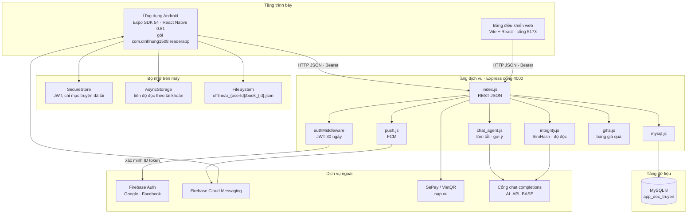
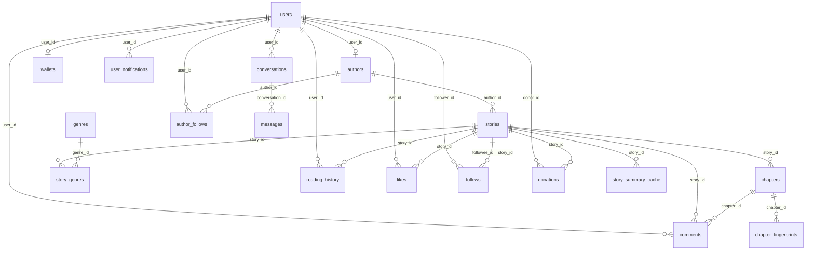

# Bổ sung — Kiến trúc, cơ sở dữ liệu, API và chức năng Android

Nội dung dưới đây được rút từ mã nguồn đang chạy của Reader App: ứng dụng Expo/React Native trong `src/`, máy chủ Express trong `admin-dashboard/server/`, và lược đồ MySQL `app_doc_truyen` trong `admin-dashboard/server/schema.sql`. Các mục đánh số theo đề cương báo cáo.

## 2.2.4. Sơ đồ kiến trúc hệ thống

Hệ thống chia thành bốn tầng. Ứng dụng Android và bảng điều khiển web cùng gọi một API REST. API đọc và ghi MySQL, đồng thời nối ra Firebase, FCM, SePay và cổng mô hình ngôn ngữ khi cần.

### Vai trò từng tầng

| Tầng | Thành phần | Việc làm |
| --- | --- | --- |
| Trình bày Android | Expo Router, gốc `src/app`. Tab Khám phá, Theo dõi, Thư viện, Xếp hạng, Tài khoản | Gọi API, giữ phiên, đọc offline, hiện quảng cáo và ví |
| Trình bày quản trị | `admin-dashboard/frontend` | CMS truyện, chương, người dùng, giao dịch, kiểm duyệt AI |
| Dịch vụ | `admin-dashboard/server/index.js`, `USE_MYSQL=true`, cổng 4000 | REST, phân quyền, paywall, ví, thông báo |
| Dữ liệu | MySQL `utf8mb4`, InnoDB | Người dùng, truyện, chương, tiến độ, ví, thông báo, nhật ký AI |
| Ngoài | Firebase, FCM, SePay, cổng mô hình | Đăng nhập mạng xã hội, đẩy thông báo, nạp xu, tóm tắt và kiểm duyệt |

Ứng dụng chọn địa chỉ API theo thứ tự trong `src/lib/api.ts`: mạng LAN `http://192.168.1.241:4000`, rồi `127.0.0.1:4000` (khi đã `adb reverse`), biến `EXPO_PUBLIC_API_BASE` hoặc `app.json` `extra.apiBase`, cuối cùng `10.0.2.2:4000` cho máy ảo Android. Ảnh bìa, banner và video quảng cáo được Express phục vụ tĩnh từ `admin-dashboard/server/public`.

Không có hàng đợi Redis hay Celery. Công việc nền nằm trong tiến trình Node: một worker chấm độ độc bình luận, khóa `GET_LOCK` của MySQL cho cửa sổ tóm tắt, và giới hạn số lời gọi mô hình đang chạy.

## 2.3. Thiết kế cơ sở dữ liệu và giao tiếp API

Cơ sở dữ liệu chuẩn là `app_doc_truyen`. Khóa chính của truyện, chương và người dùng là `story_id`, `chapter_id`, `user_id`. Một số bảng hoạt động (`reading_history`, `likes`, `follows`, `wallets`, `donations`) lưu `user_id` và `story_id` kiểu `VARCHAR`, không khai báo khóa ngoại. API vẫn nối chúng bằng giá trị chuỗi.

### Các bảng dữ liệu chính và mối quan hệ

**Tài khoản và hồ sơ tác giả**

| Bảng | Khóa và cột chính | Quan hệ |
| --- | --- | --- |
| `users` | `user_id`, `fullname`, `email` duy nhất, `password_hash`, `role` (`user`, `vip`, `author`, `admin`), `vip_until`, `firebase_uid`, `auth_method` | Gốc của mọi phiên |
| `authors` | `author_id`, `user_id` duy nhất, `pen_name`, `bio` | Một người dùng có tối đa một hồ sơ tác giả. Xóa người dùng thì xóa hồ sơ |
| `author_applications` | `application_id`, `user_id`, `pen_name`, `status` (`pending`, `approved`, `declined`) | Đơn xin làm tác giả, duyệt trên web quản trị |
| `wallets` | `user_id` duy nhất, `balance` | Số dư xu |
| `fcm_tokens` | khóa chính là `token`, kèm `user_id`, `platform` | Thiết bị Android nhận đẩy thông báo |

**Truyện, chương, thể loại**

| Bảng | Khóa và cột chính | Quan hệ |
| --- | --- | --- |
| `stories` | `story_id`, `author_id`, `title`, `description`, `cover_image`, `status` (`draft`, `ongoing`, `completed`), `genre`, `free_chapters` mặc định 3, `is_hidden`, `views` | Thuộc một tác giả. API đổi tên `cover_image` thành `cover_url`. Có chỉ mục `FULLTEXT (title, description)` |
| `chapters` | `chapter_id`, `(story_id, chapter_no)` duy nhất, `title`, `content`, `content_format`, `status` (`draft`, `pending_review`, `published`, `rejected`) | Chương mới vào hàng `pending_review`, chỉ `published` mới hiện với độc giả |
| `genres`, `story_genres` | tên thể loại duy nhất; khóa kép `(story_id, genre_id)` | Nhiều-nhiều. Cột `stories.genre` vẫn giữ thể loại chính |
| `comments` | `comment_id`, `user_id`, `story_id`, `parent_id`, `status` (`pending`, `approved`, `shadowbanned`, `rejected`), `toxicity_score` | Bình luận lồng nhau, chờ chấm độ độc |
| `likes` | cặp `(user_id, story_id)` duy nhất | Tim truyện. Số tim trên giao diện là `COUNT(*)` của bảng này |
| `chapter_views` | `user_id`, `story_id`, `chapter_id`, `viewed_at` | Lượt mở chương. Xếp hạng và “đọc tiếp” dùng bảng này, không dùng `stories.views` |
| `follows` | `(follower_id, followee_id)` | `followee_id` là mã truyện |
| `author_follows` | `(user_id, author_id)` | Theo dõi tác giả. Feed và thông báo chương mới đọc bảng này |
| `banners`, `ads` | ảnh hoặc video, `placement`, `enabled` | Banner khám phá và video xen kẽ `home`, `book-open`, `reader` |

**Tiến độ đọc**

| Bảng | Ý nghĩa |
| --- | --- |
| `reading_history` | Một dòng cho mỗi cặp `(user_id, story_id)`. `chapter_no` là chương xa nhất đã mở. `progress_pct` là phần trăm cuộn trong chương đó, không phải phần trăm cả bộ truyện |
| `reading_starts` | Hạn mức chương mỗi ngày. Khách dùng khóa `visitor:{địa chỉ IP}`, thành viên dùng `user_id`. Cặp `(user_id, story_id)` là duy nhất trong ngày logic của hạn mức |

**Ví, quà, thanh toán**

| Bảng | Ý nghĩa |
| --- | --- |
| `topup_intents` | Phiếu nạp SePay: mã `RD…`, số xu, số tiền VND, hạn 15 phút, trạng thái `pending` / `consumed` / `expired` |
| `topup_requests` | Phiếu nạp thủ công, admin duyệt |
| `payments` | Sổ giao dịch: nạp, mua VIP, mua quyền tác giả, tặng quà |
| `donations` | Quà tặng: `gift_code`, `gift_name`, `quantity`, `coins`, người tặng, tác giả nhận, truyện |
| `withdrawals` | Tác giả rút xu, trạng thái `pending`, `approved`, `processed`, `declined` |

**Thông báo và AI**

| Bảng | Ý nghĩa |
| --- | --- |
| `user_notifications` | Sự kiện `new_chapter` cho người theo dõi tác giả. Khóa duy nhất `(user_id, type, chapter_id)` |
| `notification_state` | `last_seen_at` để tính chưa đọc |
| `story_summary_cache` | Một bản tóm tắt cho cửa sổ chương `(story_id, from_chapter, to_chapter)` |
| `conversations`, `messages` | Hội thoại trợ lý đọc. `messages.trace_id` nối Langfuse khi có khóa |
| `chapter_fingerprints` | SimHash 64 bit của chương, lưu dạng chuỗi vì vượt số nguyên an toàn của JavaScript |
| `moderation_logs` | Hàng chờ kiểm duyệt độc hại hoặc đạo văn |
| `ai_usage_logs`, `ai_request_quotas`, `ai_moderation_jobs` | Nhật ký gọi mô hình, hạn mức, hàng đợi chấm bình luận |
| `chapter_recaps` | Cache chatbot cũ, không còn ghi |

### Thiết kế các API phục vụ truyện, chương, tài khoản và tiến độ đọc

Mọi thân yêu cầu và phản hồi là JSON. Ảnh bìa trong JSON là URL tuyệt đối do `formatCoverUrl` ghép. Danh sách có phân trang trả `{ books, nextCursor, hasMore }`. `limit` từ 1 đến 50.

**Tài khoản**

| Phương thức | Đường dẫn | Quyền | Việc làm |
| --- | --- | --- | --- |
| `POST` | `/auth/register` | Công khai | Body `name`, `email`, `password`. Mật khẩu từ 6 ký tự đến 72 byte. Băm bcrypt cost 10, `role = user`. Trả `201` và hồ sơ, không trả JWT |
| `POST` | `/auth/login` | Công khai | So khớp bcrypt. Trả `{ token, user }` với `user.id`, `email`, `name`, `role`. JWT hết hạn sau 30 ngày |
| `POST` | `/auth/firebase` | Công khai | Body `idToken`. Máy chủ xác minh token Firebase rồi cấp JWT. Tài khoản mới trả `201` |
| `GET` | `/me` | Bearer | Hồ sơ hiện tại, gồm vai và `vip_until` |
| `POST` | `/me/avatar` | Bearer | Cập nhật ảnh đại diện |
| `POST` | `/me/password` | Bearer | Đổi mật khẩu sau khi đối chiếu mật khẩu cũ |
| `POST` | `/auth/register-admin` | Theo mã máy chủ | Tạo tài khoản quản trị, không dùng trên ứng dụng đọc |

Payload JWT là `{ id, email, role }`, ký bằng `JWT_SECRET`.

**Truyện**

| Phương thức | Đường dẫn | Quyền | Việc làm |
| --- | --- | --- | --- |
| `GET` | `/books` | Tùy chọn | `sort` = `recent`, `views`, `likes`, `recommended`; lọc `genre`; `mine=true` chỉ truyện của tác giả đang đăng nhập |
| `GET` | `/books/search` | Công khai | `q`, `genre`, con trỏ. Tìm `FULLTEXT` trên `title` và `description` |
| `GET` | `/books/:id` | Tùy chọn | Chi tiết, số chương, đã thích hay chưa. Truyện `is_hidden` không trả cho khách |
| `GET` | `/books/liked` | Bearer | Truyện đã tim, phân trang |
| `POST` | `/books` | `author` hoặc `admin` | Tạo truyện |
| `PUT` | `/books/:id` | Chủ truyện hoặc `admin` | Sửa tiêu đề, mô tả, bìa, thể loại |
| `DELETE` | `/books/:id` | Chủ truyện hoặc `admin` | Xóa truyện |
| `POST` | `/books/import` | `author` hoặc `admin` | Tách văn bản thành tối đa 100 chương, mỗi chương tối đa 80.000 ký tự |
| `GET` | `/genres` | Công khai | Danh mục thể loại |
| `GET` | `/banners` | Công khai | Ảnh carousel màn khám phá |
| `GET` | `/authors`, `GET /authors/:id/books` | Công khai, token tùy chọn | Danh sách tác giả và truyện của một tác giả |

`views` trên thẻ truyện của ứng dụng là `COUNT(*)` từ `chapter_views`. `likes_count` là `COUNT(*)` từ `likes`. Cột `stories.views` là số liệu nhập cũ và không được màn xếp hạng dùng.

**Chương**

| Phương thức | Đường dẫn | Quyền | Việc làm |
| --- | --- | --- | --- |
| `GET` | `/books/:id/chapters` | Tùy chọn | Danh sách. Độc giả chỉ thấy `published`. Chủ truyện và admin thấy cả chương chờ duyệt |
| `GET` | `/books/:bookId/chapters/:chapterId` | Tùy chọn | Nội dung. Query `by=number` tra theo `chapter_no` |
| `POST` | `/books/:id/chapters` | Chủ truyện hoặc `admin` | Thêm chương, chạy kiểm tra đạo văn, trạng thái ban đầu `pending_review` |
| `PUT` | `/books/:bookId/chapters/:chapterId` | Chủ truyện hoặc `admin` | Sửa. Nội dung tối đa 80.000 ký tự |
| `DELETE` | `/books/:bookId/chapters/:chapterId` | Chủ truyện hoặc `admin` | Xóa chương |

Luật đọc chương, áp dụng trong `GET` nội dung:

1. Chương chưa `published`: chỉ chủ truyện và admin. Phản hồi `403` mã `chapter_pending_moderation`.
2. Vai `vip`, `author`, `admin` và chủ truyện đọc mọi chương đã xuất bản, không hạn ngày, `ad_required: false`.
3. Khách và `user`: chỉ chương có `chapter_no` không vượt `stories.free_chapters` (mặc định 3). Chương sau đó trả `403` mã `chapter_locked`.
4. Trong các chương miễn phí, khách tối đa `GUEST_DAILY_LIMIT` chương mỗi ngày (mặc định 3), thành viên thường tối đa 10. Vượt hạn trả `429` mã `guest_limit_reached` hoặc `limit_reached`.
5. Khi được đọc, phản hồi kèm `ad_required: true` với khách và thành viên thường. Máy chủ ghi `chapter_views`.

Nội dung trả về đã được `chapterForReader` gỡ thẻ quảng cáo nhúng (`ads-holder`, `ins`, `iframe`) và đưa về văn bản thuần.

**Tiến độ đọc**

| Phương thức | Đường dẫn | Quyền | Việc làm |
| --- | --- | --- | --- |
| `POST` | `/progress` | Bearer | Body `book_id`, `chapter_id`, `chapter_no`, `progress`. Ghi `reading_history` |
| `GET` | `/progress` | Bearer | Không query: cả lịch sử. Có `book_id`: một truyện |
| `GET` | `/users/:userId/progress` | Chính chủ hoặc `admin` | Cùng dữ liệu, kiểm tra đúng người |

`upsertProgress` giữ chương lớn nhất trong ba nguồn: dòng đang lưu, chương vừa gửi, và chương xa nhất trong `chapter_views`. Mở lại chương cũ không kéo bookmark lùi và không ghi đè `progress_pct` của chương xa hơn. Khi một lượt xem xa hơn thắng, `progress_pct` được đặt `NULL`.

**Theo dõi, thư viện, thông báo, ví** — các đường dẫn ứng dụng dùng thêm:

| Nhóm | Đường dẫn |
| --- | --- |
| Tim | `POST /books/:id/like`, `DELETE /books/:id/like`, `GET /books/:id/likes` |
| Theo dõi truyện | `POST /books/:id/follow`, `DELETE /books/:id/follow`, `GET /follows` |
| Theo dõi tác giả | `POST /authors/:id/follow`, `DELETE /authors/:id/follow`, `GET /following/feed` |
| Bình luận | `GET /books/:id/comments`, `POST /books/:id/comments` |
| Thông báo | `GET /notifications`, `GET /notifications/unread`, `POST /notifications/seen` |
| Đẩy | `POST /push/device`, `DELETE /push/device` |
| Ví | `GET /wallet`, `POST /wallet/topup-intent`, `GET /wallet/topup-intent/:code/status`, `POST /wallet/buy-vip`, `POST /wallet/buy-author` |
| Quà | `GET /gifts`, `GET /books/:id/gifts`, `POST /books/:id/donate` |
| Tác giả | `POST /author/apply`, `GET /authors/:id/donations`, `POST /withdrawals` |
| Trợ lý đọc | `POST /chat`, `GET /chat/conversations`, `GET /chat/conversations/:id/messages` |

`GET /following/feed` chỉ trả bài của tác giả mà người dùng đã theo dõi trong `author_follows`, gồm truyện mới và chương mới. `POST /books/:id/donate` nhận `gift_code` và `quantity` từ 1 đến 20. Giá lấy từ `gifts.js`, không lấy từ máy khách: hoa hồng 10, trà sữa 50, sư tử 100, tên lửa 200, vương miện 500 xu.

### Cơ chế xác thực, phân quyền và xử lý phản hồi từ máy chủ

**Xác thực**

1. Đăng ký email chỉ tạo dòng `users`. Ứng dụng chuyển sang màn đăng nhập.
2. Đăng nhập email đối chiếu `password_hash`. Thành công thì ký JWT.
3. Google và Facebook trên Android lấy credential gốc, đăng nhập Firebase, gửi `idToken` tới `POST /auth/firebase`. Máy chủ không tin email do ứng dụng tự khai.
4. Ứng dụng lưu JWT, hồ sơ và phương thức đăng nhập trong SecureStore với khóa `reader_app_token`, `reader_app_user`, `reader_app_auth_method`. Bản web dùng `localStorage`.
5. Mỗi lời gọi cần quyền gửi header `Authorization: Bearer <token>`.

`authMiddleware` từ chối thiếu header (`401` `missing authorization`), sai định dạng (`401` `invalid authorization format`) và chữ ký hoặc hạn dùng (`401` `invalid token`). Nếu tài khoản không còn trong MySQL thì `401` `account_unavailable`. Lỗi khi đọc vai trò mới thì `503` `authentication_unavailable`. Sau khi chữ ký hợp lệ, middleware đọc lại `users.role` để quyền tác giả hoặc VIP có hiệu lực ngay, không cần đăng nhập lại.

Đường dẫn công khai (`/books`, `/books/search`, nội dung chương) dùng `getUserFromAuthHeader`. Không có token thì vai là `guest`. Token hỏng trên các đường này bị bỏ qua, không chặn cả danh sách.

**Phân quyền theo vai**

| Vai | Được làm |
| --- | --- |
| Khách | Xem danh sách, tìm, đọc chương miễn phí trong hạn ngày |
| `user` | Thêm tiến độ, tim, theo dõi, bình luận, ví, quà. Vẫn bị paywall và hạn 10 chương/ngày |
| `vip` | Bỏ paywall và hạn ngày khi `vip_until` còn hiệu lực. Ứng dụng cũng tắt video quảng cáo |
| `author` | Quyền VIP cộng tạo và sửa truyện của mình, xem chương chờ duyệt của mình |
| `admin` | Người dùng, thể loại, banner, quảng cáo, duyệt đơn tác giả, kiểm duyệt, mọi truyện |

Sửa hoặc xóa truyện so khớp `author_user_id` với `req.user.id`. Không khớp thì `403` `not your book` hoặc `forbidden`. Tiến độ của người khác chỉ admin đọc được.

Nâng VIP trừ `VIP_COST_COINS` (mặc định 500) rồi cộng một tháng vào `vip_until` và đặt `role = vip`. Thất bại thì hoàn xu. Mua quyền tác giả giá 800 xu, hoặc 300 xu nếu VIP còn ít nhất 15 ngày. Máy chủ tự tính giá. Thành công thì tạo dòng `authors`, đặt `role = author` và cộng một tháng VIP.

**Xử lý phản hồi**

Máy chủ trả mã HTTP cùng thân JSON `{ error, message? }`. Các mã ứng dụng hay gặp:

| Mã HTTP | `error` | Khi nào |
| --- | --- | --- |
| 400 | `invalid_credentials`, `email exists`, `book_id required`, `unknown_gift`, `insufficient_funds` | Dữ liệu sai hoặc không đủ xu |
| 401 | `missing authorization`, `invalid token`, `login_required` | Thiếu hoặc hết phiên. Tóm tắt chương cũng trả `login_required` |
| 403 | `forbidden`, `chapter_locked`, `chapter_pending_moderation` | Sai vai hoặc chương khóa |
| 404 | `not found` | Không có truyện hoặc chương |
| 409 | `email exists` | Trùng email lúc ghi |
| 413 | `content_too_large`, `import_too_large` | Thân quá dài |
| 429 | `guest_limit_reached`, `limit_reached`, `ai_busy` | Hết hạn đọc hoặc hàng đợi AI đầy |
| 500 | `internal` | Lỗi không phân loại |
| 503 | `busy`, `authentication_unavailable` | Khóa đọc chương đang bận |

Hàm `request` trong `src/lib/api.ts` thử lần lượt các địa chỉ gốc. Hết địa chỉ thì trả `{ error: 'network', message }`. Khi có phản hồi HTTP, hàm đọc thân dạng chữ rồi `JSON.parse`. Màn hình kiểm tra trường `error` hoặc `token` trước khi coi là thành công. Quảng cáo trong trình đọc chỉ hiện khi thân chương có `ad_required: true` và `shouldShowAds` còn đúng. Một thân có `error` (kể cả hết hạn khách) được hiện là lỗi, không thay bằng chương giả.

## 2.4. Triển khai các chức năng chính trên Android

Ứng dụng là Expo Router. `src/app/index.tsx` hiện splash khoảng 5 giây rồi vào `/home`. Home cho đăng nhập, đăng ký, hoặc khám phá với tư cách khách. Năm tab nằm trong `src/app/(tabs)/_layout.tsx`, tab mở đầu là Khám phá. Gói Android `com.dinhhung1508.readerapp`, `minSdk` 24, SDK biên dịch 36, quyền `POST_NOTIFICATIONS`. Trạng thái giao diện dùng React context `AppTheme` (cỡ chữ 14–28, giãn dòng, nền đêm), không dùng Redux.

### Đăng nhập, đăng ký và quản lý phiên người dùng

Màn `src/app/(auth)/login.tsx` và `register.tsx` gọi `src/lib/auth.ts`.

- Đăng ký gửi `POST /auth/register`. Thành công thì báo và chuyển về màn đăng nhập vì phản hồi không có JWT.
- Đăng nhập email gọi `POST /auth/login`. Có `token` thì lưu SecureStore, gọi `hydrateReadingProgress`, rồi `router.replace` vào tab Khám phá.
- Google dùng `@react-native-google-signin/google-signin` và Firebase Auth. Facebook dùng `react-native-fbsdk-next`. Cả hai kết thúc ở `POST /auth/firebase`. Expo Go không có module gốc này. Khi thiếu module, ứng dụng báo dùng email.
- Phiên còn sống khi `getToken()` khác rỗng. `GET /me` làm mới hồ sơ trên màn Tài khoản.
- Đăng xuất trên Android lấy token FCM, gọi `DELETE /push/device`, đăng xuất Google và Firebase, rồi xóa ba khóa SecureStore. Tiến độ trong AsyncStorage gắn theo `userId` nên không xóa nhầm tiến độ tài khoản khác.

Khách không có JWT vẫn mở Khám phá, chi tiết và các chương miễn phí.

### Khám phá, tìm kiếm, xem chi tiết và đọc truyện

**Khám phá** (`src/app/explore.tsx`, tab tái xuất cùng file):

- `GET /banners` cho carousel.
- `GET /books?limit=50&sort=recent`, rồi `pickHomeRecommendations` chọn 5 truyện cho khối “Truyện mới cập nhật”. Làm mới lần sau cố tránh đúng bộ vừa hiện. Nút “Tìm thêm” mở `/search`.
- Thêm hai danh sách ngắn `sort=views` và `sort=recommended`.
- Video xen kẽ vị trí `home` hiện một lần mỗi phiên, qua được sau 15 giây. VIP còn hạn, tác giả và admin không xem video.

**Tìm kiếm** (`src/app/search.tsx`): ô tìm gọi `GET /books/search`. Chọn thể loại mà không gõ từ khóa thì gọi `GET /books` với `sort=views` và `genre`. Kết quả phân trang bằng `cursor`.

**Chi tiết** (`src/app/book/[id].tsx`): `GET /books/:id`, `GET /books/:id/chapters`, bình luận, nút thích và theo dõi. Nút đọc tiếp lấy chương xa nhất từ `getReadingProgress`. Nếu API truyện lỗi, màn này còn một nhánh hiển thị sách mẫu. Nội dung chương thật không đi qua nhánh đó.

**Đọc** (`src/app/reader/[id].tsx`):

1. Tìm chương trong file offline trước.
2. Không có thì `GET /books/:id/chapters/:chapterNo?by=number`.
3. Cuộn dọc. Tiêu đề trong trang chỉ là “Chương N”.
4. Chương trước và sau đổi `chapterIndex` và trượt ngang.
5. Nếu `ad_required` và tài khoản còn phải xem quảng cáo, phát video vị trí `reader`.
6. Tờ trợ lý `ReaderAgentSheet` gửi `POST /chat` với `book_id` và `chapter_no`. Tóm tắt đòi đăng nhập. Gợi ý trả thẻ truyện qua `StoryFlashcards`.

### Lưu tiến độ đọc và đồng bộ tiến độ với máy chủ

Hai lớp lưu trữ dùng chung luật “chương xa nhất thắng”, cài trong `src/lib/readingProgress.js`.

**Trên máy.** `src/lib/reading.ts` ghi AsyncStorage. Khóa khách là `reader_app_reading:guest`. Khóa đã đăng nhập là `reader_app_reading:u:{userId}`. Mỗi truyện một bản ghi: `bookId`, `chapterNo`, `progressPct`, tiêu đề, bìa, thời điểm.

**Khi đang đọc.** Mở chương gọi `saveReadingProgress` ngay. Nếu là đúng chương bookmark thì giữ `progressPct` cũ để khôi phục vị trí cuộn. Nếu là chương mới xa hơn thì phần trăm bắt đầu từ 0. Trong lúc cuộn, ứng dụng đợi 800 ms rồi gửi lại phần trăm. `chooseReadingBookmark` không cho chương nhỏ hơn ghi đè chương lớn hơn.

**Lên máy chủ.** Nếu có JWT, `saveReadingProgress` gọi `POST /progress`. Phản hồi được trộn lại. `GET /progress?book_id=` dùng ở chi tiết truyện. `GET /progress` dùng ở Thư viện.

**Lúc đăng nhập.** `hydrateReadingProgress` gộp map khách vào map người dùng, xóa khóa khách, đẩy từng mục lên `POST /progress`, rồi kéo `GET /progress` và trộn theo chương xa nhất. Mất mạng thì Thư viện vẫn đọc bản AsyncStorage của đúng tài khoản.

Thanh tiến độ màu cam là `progress_pct` trong chương bookmark, không phải số chương đã đọc chia tổng chương.

### Tải truyện, chương truyện để đọc ngoại tuyến

`src/lib/offline.ts` tải trên máy, không có API “download” riêng.

1. Phạm vi là `u_{userId}` hoặc `guest`.
2. Chỉ mục nằm ở SecureStore, khóa `reader_app_offline_index_v1_{scope}`.
3. Nội dung là một file JSON `offline/{scope}/book_{id}.json` trong thư mục tài liệu của ứng dụng.
4. `downloadBookOffline`, gọi từ nút trên màn chi tiết, lần lượt `GET` truyện, danh sách chương, rồi từng chương. Chương đầu rỗng thì hủy cả lượt tải. Lỗi ở chương sau ghi file với `partial: true` và dừng.
5. Trình đọc gọi `getOfflineChapter` trước khi gọi mạng. Có nội dung thì không xin chương từ máy chủ và vẫn ghi tiến độ cục bộ.
6. Tab Thư viện mục “Đã tải” đọc `listOfflineBooks`. Gỡ tải xóa file và xóa chỉ mục.

Bản tải gắn với tài khoản đang đăng nhập trên máy. Đổi tài khoản không nhìn thấy file của tài khoản kia vì khác thư mục và khác khóa chỉ mục.

### Quản lý thư viện, theo dõi truyện và thông báo

**Thư viện** (`src/app/(tabs)/library.tsx`) có ba đoạn:

| Đoạn | Nguồn |
| --- | --- |
| Đang đọc | `getReadingList()`. Dòng không có tiêu đề bị bỏ. Rỗng thì câu “Chưa có truyện đang đọc” |
| Đã thích | `GET /books/liked`, 20 mục mỗi trang |
| Đã tải | `listOfflineBooks()` |

**Theo dõi** (`src/app/(tabs)/follow.tsx`):

- Có token thì `GET /following/feed?limit=30`. Bài cũ hơn 3 ngày bị lọc trên máy. Khách thấy feed trống.
- Gợi ý tác giả lấy từ `GET /authors`, chọn 4 người bằng `pickHomeRecommendations`.
- Bấm theo dõi gọi `POST /authors/:id/follow`. Bỏ theo dõi gọi `DELETE`.
- Màn chi tiết truyện còn `POST /books/:id/follow` để ghi bảng `follows`. Feed chương mới đi theo `author_follows`, không đi theo `follows`.

**Thông báo:**

- Sau hai chương đọc thành công, `src/lib/pushNotifications.ts` xin `POST_NOTIFICATIONS` trên Android 13 trở lên, lấy token FCM và `POST /push/device`.
- Khi chương chuyển sang `published`, `notifyChapterPublished` chèn `user_notifications` cho mọi người trong `author_follows` của tác giả đó, trừ chính tác giả, rồi `push.js` gửi FCM. Token hỏng bị xóa.
- Màn `src/app/notifications.tsx` gọi `GET /notifications?limit=50`. Vào màn thì `POST /notifications/seen`, cập nhật `notification_state.last_seen_at`.
- Chạm một mục mở `/reader/[id]` đúng chương. `src/app/_layout.tsx` cũng bắt thông báo FCM khi ứng dụng đang mở để điều hướng cùng cách.
- Đăng xuất gỡ token thiết bị khỏi `fcm_tokens`.

### Ví xu, VIP, tặng quà và các chức năng dành cho tác giả

**Ví và VIP** nằm ở `src/app/profile.tsx` và `src/app/account.tsx`.

- `GET /wallet` hiện số dư.
- Nạp xu: người dùng chọn số xu. Giá VND là số xu nhân `COIN_VND` (mặc định 100). `POST /wallet/topup-intent` tạo mã `RD…` và QR VietQR, hạn 15 phút. Ứng dụng hỏi `GET /wallet/topup-intent/:code/status` mỗi 3 giây. `QRPaymentModal` hiện mã.
- Môi trường hiện tại `SEPAY_LOCAL=true` nên nút xác nhận gọi `POST /sepay/local-pay` và cộng xu ngay, không qua ngân hàng. Khi tắt cờ này, nút chỉ kiểm tra lại xem webhook `POST /sepay/webhook` đã cộng chưa. Webhook đòi header `Authorization: Apikey`.
- Mua VIP gửi `POST /wallet/buy-vip`. Giá hiển thị 500 xu. Thiếu xu thì báo nạp thêm. Thành công thì làm mới hồ sơ, vai `vip`, `vip_until` cộng một tháng.
- `shouldShowAds` tắt video với admin, tác giả, và VIP còn hạn. Hết `vip_until` thì quảng cáo hiện lại. Banner khám phá không lọc theo VIP.

**Tặng quà.** `AuthorGiftCard` trên màn chi tiết gọi `GET /gifts` và `GET /books/:id/gifts`. Chưa đăng nhập thì chuyển tới đăng nhập. Số dư không đủ thì chuyển tới Tài khoản. Gửi `POST /books/:id/donate` với `gift_code` và `quantity`. Máy chủ từ chối tự tặng và từ chối người nhận là admin. Trừ xu người tặng, cộng xu tác giả, ghi `donations` và `payments` trong `transferGift`. Thông báo trong ứng dụng kèm tên quà, emoji và số lượng. Hiệu ứng dùng Reanimated và Lottie. Thiếu module gốc thì còn ảnh tĩnh.

**Tác giả trên Android:**

| Việc | Màn và API |
| --- | --- |
| Mua quyền tác giả | Profile gọi `POST /wallet/buy-author`. Giá 800 xu, hoặc 300 xu khi VIP còn ít nhất 15 ngày. Ứng dụng chỉ hiện giá. Máy chủ tính lại |
| Đơn xin bút danh | `POST /author/apply` với `pen_name`, `bio`, `samples`. Admin duyệt bằng `PUT /author/applications/:id` trên web |
| Tạo và sửa truyện | `src/app/author/create.tsx`, `src/app/author/manage.tsx`. `POST /books`, `PUT /books/:id`, `DELETE /books/:id`, cùng các API chương. Danh sách của tôi là `GET /books?mine=true` |
| Nhập chương từ file | `ChapterImportModal` đọc docx hoặc văn bản rồi `POST /books/import` hoặc tạo từng chương. Chương mới ở `pending_review` đến khi SimHash ở vùng xanh hoặc admin cho xuất bản |
| Xem quà và rút xu | `GET /authors/:id/donations`, `POST /withdrawals`. Admin xử lý `PUT /withdrawals/:id` |
| Trang công khai | `src/app/author/[id].tsx` gọi `GET /authors/:id/books` |

Tác giả và admin không bị paywall trên truyện của mình và không xem video xen kẽ. Hết tháng VIP không tự gỡ vai `author` và không tự ẩn lại truyện. Việc ẩn `is_hidden` là cờ trên `stories`, độc lập với hạn VIP sau khi đã là tác giả.
