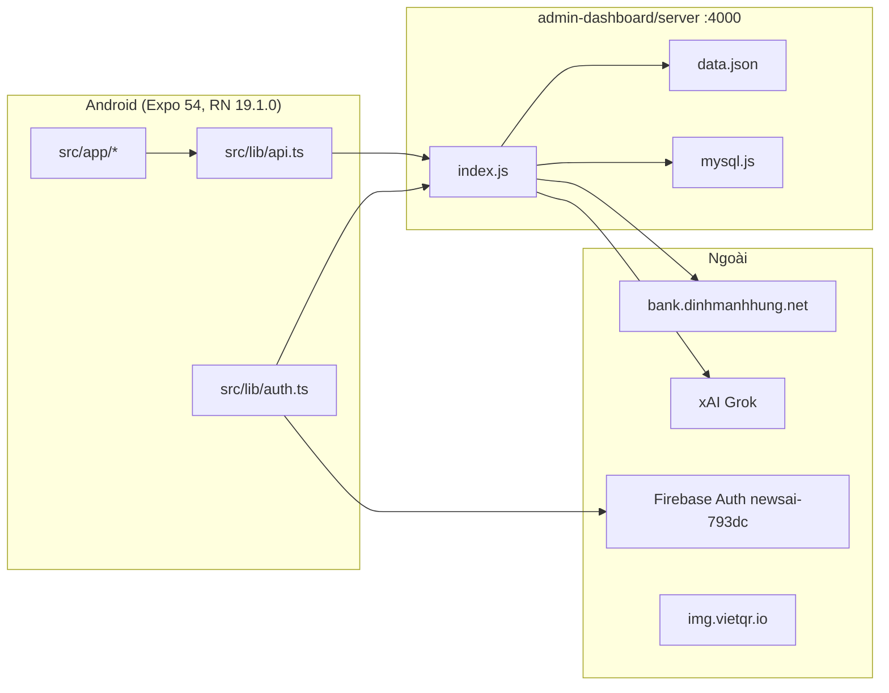
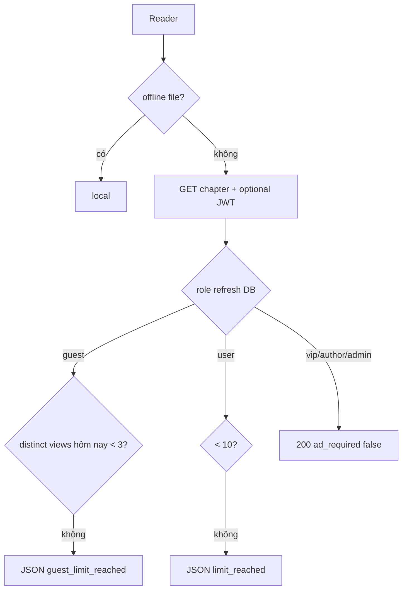
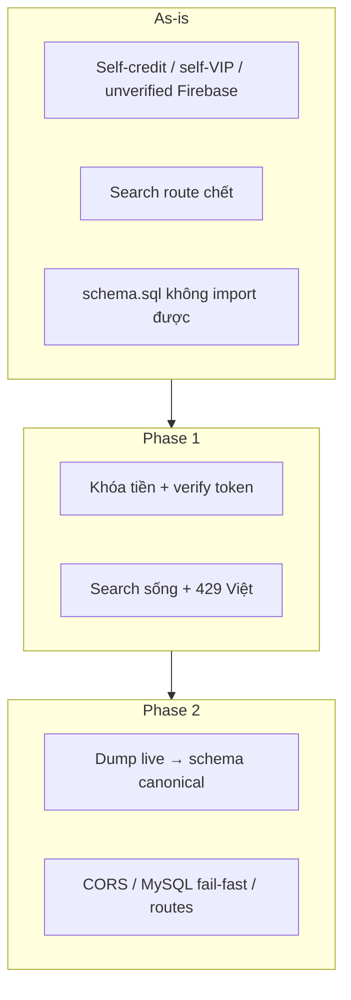

# PRD + Thiết kế kỹ thuật: Reader App

| Trường | Giá trị |
|---|---|
| **Tài liệu** | Product Requirements Document (hybrid PRD + technical design) |
| **Sản phẩm** | Reader App — ứng dụng đọc truyện chữ Việt Nam |
| **Phiên bản sản phẩm hiện tại** | 1.0.0 (README cập nhật 2026-01-14) |
| **Phiên bản tài liệu** | Draft 0.3 |
| **Ngày** | 2026-09-12 |
| **Tác giả** | Grok Design / Hoàng Huy |
| **Trạng thái** | Draft |
| **Nguồn sự thật** | Codebase `e:\TTCS\Appdoctruyen\Reader_app` (ưu tiên code khi README lệch) |
| **Đối tượng đọc** | Developer chính (Hoàng Huy), mentor TTCS, kỹ sư sẽ implement Phase 1–2 |

---

## Overview

Reader App là sản phẩm đọc truyện chữ (web-novel / e-book) tiếng Việt, gồm **ba tầng đã tồn tại**: ứng dụng Android (React Native 19.1.0 + Expo SDK 54), backend Express.js (một file `admin-dashboard/server/index.js` ~3200 dòng), và admin dashboard React **18.2.0** + Vite. Sản phẩm đã có vòng đời độc giả ở mức prototype: đăng nhập (email bcrypt / Google / Facebook), khám phá–tìm kiếm–xếp hạng, đọc chương với giới hạn ngày, tải offline, like/follow/comment, ví xu + VIP + donate, quảng cáo video, chatbot Grok, và luồng tác giả tạo/sửa truyện.

Tài liệu này **không phát minh sản phẩm mới**. Nó formalize sản phẩm *as-is* thành yêu cầu có ID và khóa phạm vi **ổn định tính năng đã có**. **Phase 1 = security (tiền tệ + auth) + sửa search chết + docs/copy** — không rewrite schema, không panel admin mới, không `src/types`, không pino. Schema canonical và tách `routes/` là **Phase 2**. Phase 3+ để trống cho user.

---

## Background & Motivation

### Bối cảnh

Đồ án TTCS / sản phẩm indie của Hoàng Huy. Thị trường: độc giả truyện chữ Việt trên Android. Hệ thống **tự host nội dung**, không phải aggregator.

### Hiện trạng (đã verify trong code)

- Mobile: `src/app/` (Expo Router v6), `src/lib/api.ts`, `src/lib/auth.ts`. React **19.1.0**. **Không có** `React.createContext` dưới `src/` (README ghi “React Context” — sai).
- Backend: `admin-dashboard/server/index.js` + `mysql.js`. Express `^4.18.2`, `mysql2`, `jsonwebtoken`, `bcryptjs`, `multer`. **Không có** `firebase-admin`.
- Admin frontend `package.json`: React **18.2.0** (README chính ghi nhầm React 19 cho cả stack).
- Email/password: `login.tsx` → `Auth.login` → `POST /auth/login` (bcrypt Express). **Không** đi Firebase. README diagram gộp mọi method vào Firebase — sai.

### Pain points (P0 trước schema)

1. **Lỗ tiền tệ / auth (chặn production).** `POST /wallet/topup` cộng xu cho user đã login; `POST /users/:id/vip` và `POST /payments` tự nâng VIP; `POST /payments/webhook` nâng VIP khi **không** set `PAYMENT_WEBHOOK_SECRET`; `POST /wallet/buy-vip` tin `cost_coins`; `POST /wallet/verify-payment` tin `coins`/`amount` client, ghi `provider_ref: auto_verify_${Date.now()}` (không dedupe `paymentCode`); `POST /auth/firebase` không verify `idToken`; JWT fallback `'dev_secret_change_me'`; `apiSubscribeVip` gọi free VIP (chưa gắn UI nhưng là footgun).
2. **`GET /books/search` chết.** Đăng ký sau `GET /books/:id` (index.js ~942 vs ~3135) → `id=search`. SQL chọn cột không tồn tại (`cover_url`, `views`, `likes_count`, `a.author_name`).
3. **Paywall docs ≠ code.** README migration = progressive `reading_starts` theo `chapter_no`. Code = `chapter_views` distinct/ngày (guest 3, user 10).
4. **Schema không import được trên DB trống.** `schema.sql` tạo `books` rồi `ALTER TABLE stories`. Repo **không có** `CREATE TABLE users` hay `CREATE TABLE reading_history`. Runtime `CREATE TABLE IF NOT EXISTS` không cover hai bảng đó. Default `mysql.js`: DB `app_doc_truyen`, password `123456`.
5. **JSON fallback subset.** Auth/wallet/VIP/comments/ads/search = `requires MySQL mode`. `POST /books` JSON-mode **không auth**.
6. **Guest quota spoof.** Visitor key = `x-forwarded-for` không `trust proxy` — client CORS `*` có thể xoay header và reset 3 chương/ngày.

---

## Product vision, problem, target users

### Vision

App đọc truyện chữ tiếng Việt trên Android: độc giả tìm–đọc–offline–nâng VIP; tác giả xuất bản và nhận donate trong **cửa sổ thời gian trả phí hiện tại (~30 ngày, xem entitlements)**; admin CMS web. Không phải mạng xã hội, không phải chợ truyện, không phải iOS-first.

### Problem

Thiếu app tự host có phân quyền guest/user/VIP/author/admin, monetize xu + VIP + ads, CMS cho một người vận hành.

### Target users

| Actor | Mô tả | Kênh |
|---|---|---|
| Độc giả (guest hoặc `role=user`) | Đọc, tìm, like, follow, comment, nạp xu | Android |
| Độc giả VIP (`role=vip` **và** `vip_until` còn hạn) | Unlimited đọc, không ads; hết hạn → `user` | Android |
| Tác giả (`role=author` **và** `vip_until` còn hạn) | Tạo/sửa truyện, nhận donate, rút xu (API). **As-is: hết `vip_until` → `role=user` và ẩn stories** | Android |
| Admin (`role=admin`) | CRUD user/sách/banner/ads, duyệt nạp xu, moderate comment | Web `:5173` |

---

## Personas và jobs-to-be-done

### P-01 — Mai, độc giả 19 tuổi

JTBD: tìm truyện, đọc tiếp đúng chương, offline, không bắt login ngay. Success: splash → chương; offline khi mất mạng.

### P-02 — Huy, độc giả trả phí

JTBD: nạp xu, mua VIP, binge. Success: QR → xu → VIP 500 xu → ads/limit biến mất (`refreshUserVipStatus` + `updateUserVip` luôn +1 tháng từ NOW).

### P-03 — Lan, tác giả nghiệp dư

JTBD: mua quyền tác giả, đăng chương, nhận donate. **As-is code:** 800/300 xu mua **~30 ngày** (`updateUserVip` `monthsToAdd = 1`); hết hạn demote + ẩn truyện. Không giả định vĩnh viễn.

### P-04 — Admin Hoàng Huy

JTBD: duyệt nạp xu, ẩn truyện rác, stats, banner/ads.

---

## Goals & Non-Goals

### Goals

1. Khóa sản phẩm hiện tại thành FR có ID / ưu tiên / status code.
2. **Phase 1:** đóng lỗ tiền tệ + Firebase verify + JWT fail-fast + sửa search chết + copy paywall 429 tiếng Việt + README khớp code.
3. **Phase 2:** schema canonical (kèm dump live DB), secrets/CORS, smoke đã có từ Phase 1, tách routes.
4. Roadmap Phase 0–2; Phase 3+ trống.

### Non-Goals (Phase 0–2)

- Rewrite NestJS / Prisma / microservice.
- iOS App Store, Play Billing, AdMob, marketplace, audiobook, forum.
- Admin bảng giá, form apply-author trên profile, panel withdrawals — **blocked Open Questions**.
- `src/types` đầy đủ, redesign `request()` thành `{ok,status,data}`, pino, Sentry, PM2, pagination `GET /books`, rate limit, gắn `AdBanner` / banner CMS — **polish, không Phase 1**.
- Đổi hành vi author vĩnh viễn vs 30 ngày — **không im lặng đổi**.
- Drop JSON fallback cho đến khi user chốt.

### Future opportunities (không committed)

iOS + Apple Sign-In; progressive unlock; import `.txt` UI; apply-author form; banner CMS; AdMob. **Không** đưa vào Phase 1.

---

## Current-state inventory

### 1. Kiến trúc as-is



**API_BASE** (`src/lib/api.ts` dòng 4): `extra.apiBase || process.env.EXPO_PUBLIC_API_BASE || 'http://10.0.2.2:4000'`. `app.json extra.apiBase` = `http://172.16.58.47:4000` thắng env. Copilot-instructions nói ngược.

### 2. Mobile screens

| Route file | URL | Việc làm | Ghi chú |
|---|---|---|---|
| `src/app/index.tsx` | `/` | Splash 5s → `/home` | |
| `src/app/home.tsx` | `/home` | Login / register / guest; token → explore | Không phải feed |
| `src/app/(auth)/login.tsx` | `/login` | Email bcrypt + Google + Facebook | Email **không** Firebase |
| `src/app/(auth)/register.tsx` | `/register` | `apiRegister` | Không nhận JWT |
| `src/app/explore.tsx` + `(tabs)/explore.tsx` | `/explore` | Đề xuất | Re-export |
| `src/app/(tabs)/follow.tsx` | `/follow` | Author + feed | |
| `src/app/(tabs)/library.tsx` | `/library` | Local progress, liked, offline | |
| `src/app/(tabs)/rank.tsx` | `/rank` | Sort views | Tab label **"Diễn đàn"** — **không đổi Phase 1** (OQ8) |
| `src/app/profile.tsx` | `/profile` | Ví, QR, mua VIP/author | `(tabs)/profile.tsx` re-export |
| `src/app/search.tsx` | `/search` | Client filter `GET /books` | Debounce 300ms; `request()` không throw HTTP |
| `src/app/book/[id].tsx` | `/book/:id` | Like, follow **author**, comment, donate, offline | `apiFollowBook` không gọi |
| `src/app/reader/[id].tsx` | `/reader/:id?ch=` | Đọc, theme/font | Offline-first |
| `src/app/author/create.tsx` / `manage.tsx` / `[id].tsx` | | CRUD truyện / profile tác giả | |
| `src/app/chatbot.tsx` | `/chatbot` | `POST /chat` | |
| `src/app/account.tsx` / `notifications.tsx` | | Hồ sơ, noti | |

Tab bar: Khám phá / Theo dõi / Thư viện / Diễn đàn / Tôi.

### 3. Mobile libs

| Path | Vai trò |
|---|---|
| `src/lib/api.ts` | `request()` parse JSON; network → `{error:'network'}`; **không** expose `res.status` |
| `src/lib/auth.ts` | Token `reader_app_token`; **Google webClientId hardcode** `220903784873-rn1gdgqifur44r8am7a0h8mb0meh11v5.apps.googleusercontent.com` |
| `src/lib/firebase.ts` | Web config `newsai-793dc`; `GOOGLE_WEB_CLIENT_ID` cùng web id; `GOOGLE_ANDROID_CLIENT_ID` `220903784873-e97pe3tvjpab7cd8r3acg3fipe7e1412...` |
| `app.json extra` | `googleWebClientId` / `googleAndroidClientId` / `googleExpoClientId` = `""` — **không dùng**. Source of truth native = `auth.ts` |
| `src/lib/offline.ts` | `offline/book_<id>.json`; index `reader_app_offline_index_v1` |
| `src/lib/reading.ts` | Key **`reader_app_reading`** (README ghi sai `_v1`) |
| `src/lib/ads.ts` | Ẩn ads vip/author/admin; **`vip_until` truthy cũng ẩn ads** kể cả role đã `user` nếu cache cũ |
| `QRPaymentModal.tsx` | MB `123406072004`, poll 5s `POST /wallet/verify-payment` |
| `AdBanner.tsx` | Unused |
| `src/types/` | Rỗng |

Hàm API **không screen nào gọi:** `apiApplyAuthor`, `apiImportBook`, `apiTopUpWallet`, `apiSubscribeVip` (footgun free VIP), `apiFollowBook`.

### 4. Backend endpoints

**Auth:** `POST /auth/register` (không JWT); `POST /auth/login`; `POST /auth/firebase` (tin body `firebase_uid`); `POST /auth/register-admin`; `GET/POST /me/*`.

**Catalog:** CRUD `/books`, chapters, genres, `/books/import`, **`GET /books/search` unreachable**.

**Social:** likes, follows story/author, feed, comments (insert `status='approved'` + Grok `is_negative`), notifications computed.

**Money:** `GET /wallet`; `POST /wallet/topup` self-credit; topup-request + approve (check-then-credit, **không** `UPDATE … WHERE status='pending'`); `POST /wallet/verify-payment` client coins/amount; `POST /wallet/buy-vip` client price; `POST /wallet/buy-author` server 800/300; `POST /users/:id/vip` self; `POST /payments` self VIP; `POST /payments/webhook` open nếu thiếu secret; donate; author apply; withdrawals debit ngay; admin `POST /users/:id/wallet/topup`.

**Misc:** banners, ads, `GET /stats` (`income = SUM(payments.amount)` — gồm hàng coin `amount=0` và topup VND), `POST /chat` no auth, bookmarks, `POST /progress` → `reading_history`, `GET /users/:id/progress` không `book_id` → **`reading_progress` (bảng không được CREATE)**. `POST /debug/token` nếu `ALLOW_DEV_TOKENS=true`.

**authMiddleware** (`index.js` 1051–1058): bypass khi header `x-bypass-auth: true` **AND** (`ALLOW_DEV_TOKENS=true` **OR** hostname/ip localhost/127/::1). Request LAN `http://172.16.58.47:4000` **không** `_local` trừ khi `ALLOW_DEV_TOKENS`. Footgun: `frontend/src/api.js` gửi `X-Bypass-Auth: true` khi không token tới **localhost**. Cùng bypass copy trên `POST /books` / upload, không chỉ middleware.

### 5. Data entities

| Entity | Bảng | Ghi chú |
|---|---|---|
| User | `users` | **Repo không CREATE.** `createUser` INSERT giả định bảng có sẵn (live DB `app_doc_truyen`) |
| Author | `authors` | Runtime CREATE |
| Story | `stories` | Runtime; API `id`←`story_id`, `cover_url`←`cover_image` |
| Chapter | `chapters` | Probe `chapter_id`/`id`, `story_id`/`book_id` |
| Genre | `genres` + `story_genres` | `schema.sql` junction FK `books(id)` — lệch runtime `stories` |
| Wallet | `wallets` | `balance`; mobile `coins ?? balance` |
| Topup | `topup_requests` | |
| Payment | `payments` | `provider_ref` **không unique** |
| Donation / withdrawal / author_applications | runtime CREATE | Không UI admin |
| Like / follows | `likes`; `follows` CREATE dùng `follower_id`/`followee_id` nhưng probe cũng nhận `user_id`/`story_id` | |
| Comment | `comments` | Insert **luôn `approved`**; `is_negative` chỉ flag |
| `chapter_views` | paywall + views | |
| `reading_history` | **Repo không CREATE.** `upsertProgress` ghi đây | Canonical progress |
| `reading_progress` | **Không tồn tại.** GET all-rows đọc đây → 500/empty | **Drop / đừng tạo** |
| `reading_starts` | migration file | Paywall **không dùng** |
| banners, ads, notification_state | runtime | |

`schema.sql` fail trên DB mới (`ALTER TABLE stories` khi chỉ có `books`).

### 6. Roles & entitlements (as-is — không đổi Phase 1)

| Role | Đọc | Ads | Tạo truyện | Hết `vip_until` |
|---|---|---|---|---|
| guest | 3 distinct chapter/ngày theo IP/`x-forwarded-for` | Có | Không | — |
| `user` | 10/ngày | Có | Không | — |
| `vip` | Unlimited, `ad_required: false` | Không | Không | `refreshUserVipStatus` → `role=user`, `vip_until=NULL` |
| `author` | Unlimited, không ads | Không | Có (khi còn hạn) | **Cùng helper:** `role=user` **và** `setAuthorStoriesHiddenByUserId(..., true)` |
| `admin` | Unlimited | Không | Có | Không expire |

`updateUserVip` (`mysql.js` ~1244–1285): `monthsToAdd = 1` hardcoded; **bỏ qua** `months`/`days` từ caller trừ nhánh `until`. `POST /wallet/buy-author` gọi `updateUserVip(..., { role: 'author' })` → `vip_until = NOW() + 1 MONTH` rồi unhide stories. `POST /wallet/buy-vip` chỉ `{ role: 'vip' }` → cùng +1 tháng.

**Không** implement “author vĩnh viễn” từ bảng cũ Draft 0.1.

JSON chapter path (`useMysql=false`): **không** paywall, luôn 200.

### 7. Admin dashboard

Routes: dashboard, books, chapters, banners, ads, genres, users, transactions, comments; nav **Cài đặt** không panel. Thiếu UI: author applications, withdrawals. Comments admin filter default `pending` nhưng live insert là `approved` → hàng đợi pending **thường rỗng** trừ comment cũ.

### 8. Build / identity

Package `com.dinhhung1508.readerapp`. EAS `4009c1a7-1787-4753-9490-717bd2b5df73`. Preview `EXPO_PUBLIC_API_BASE=http://172.16.58.47:4000`. Production profile **không** set API base. `google-services.json` **đang trong repo**. Facebook appID + clientToken trong `app.json` và `strings.xml`.

---

## Functional requirements

P0 = mất tiền / mất auth / feature cốt lõi gãy. P1 = nửa vời. P2 = polish. Status 2026-09-12.

### Độc giả

| ID | Yêu cầu | Pri | Status | Evidence |
|---|---|---|---|---|
| FR-READER-01 | Splash → landing / explore | P0 | exists | |
| FR-READER-02 | Đăng ký email | P0 | partial | Không trả JWT — **Phase 1 optional nhỏ**, không block money |
| FR-READER-03 | Login email bcrypt + JWT | P0 | exists | Không Firebase |
| FR-READER-04 | Google Sign-In | P0 | partial | Native OK; server không verify |
| FR-READER-05 | Facebook | P1 | partial | |
| FR-READER-06 | Guest | P0 | exists | |
| FR-READER-07 | Khám phá list | P0 | exists | `GET /books` không pagination — OK &lt;50 truyện |
| FR-READER-08 | Tìm tên/thể loại | P0 | partial | Dead `/books/search`; client filter. P0 = **sửa bug route+cột**, không vì “catalog sẽ lớn” |
| FR-READER-09 | Xếp hạng views | P1 | exists | Label “Diễn đàn” — **không đổi Phase 1** |
| FR-READER-10–11 | Chi tiết + đọc | P0 | exists | |
| FR-READER-12 | Paywall guest/user vs VIP/author/admin | P0 | partial | Code distinct/day; docs khác; copy 429 English |
| FR-READER-13 | Progress | P0 | partial | Local; server lệch bảng. **Không sync Phase 1** |
| FR-READER-14 | Offline | P0 | partial | Fail-soft empty; không bypass 429 (guest) |
| FR-READER-15 | Like | P1 | exists | |
| FR-READER-16 | Follow truyện | P2 | exists API, unused UI | |
| FR-READER-17 | Follow author + feed | P1 | exists | |
| FR-READER-18 | Comment + xóa | P1 | exists | Insert **auto-approved** |
| FR-READER-18b | Grok gắn `is_negative` trên comment | P2 | exists | Gửi **toàn bộ text comment** lên xAI; vẫn `status=approved`. Mobile có `revealedNegative` |
| FR-READER-19 | Donate | P1 | exists | |
| FR-READER-20 | Nạp xu QR | P0 | partial | Client coins; không idempotent |
| FR-READER-21 | Mua VIP xu | P0 | partial | Server tin `cost_coins` |
| FR-READER-22 | Chatbot | P2 | exists | Không Phase 1 rate limit |
| FR-READER-23 | Interstitial | P1 | partial | Banner unused |
| FR-READER-24–25 | Noti, avatar, password | P1 | exists | |
| FR-READER-26 | Banner home | P2 | missing | **Không Phase 1** |

### Tác giả

| ID | Yêu cầu | Pri | Status | Evidence |
|---|---|---|---|---|
| FR-AUTHOR-01 | Mua author bằng xu | P0 | exists | 800/300; **gắn `vip_until` +1 tháng** |
| FR-AUTHOR-02 | Đơn xin author | P1 | partial | API only. **Không UI Phase 1** (OQ5) |
| FR-AUTHOR-03–04 | CRUD truyện/chương | P0 | exists | |
| FR-AUTHOR-05 | Import TXT | P1 | partial | Không UI. **Không Phase 1** |
| FR-AUTHOR-06 | Ẩn truyện khi hết hạn author | P0 | **exists (surprising)** | Trigger = `refreshUserVipStatus` trên `getUserByEmail`/`getUserById`. **Không đổi** đến OQ-AUTHOR |
| FR-AUTHOR-07 | Nhận donate | P0 | exists | |
| FR-AUTHOR-08 | Rút xu | P1 | partial | **Không UI Phase 1** (OQ6) |
| FR-AUTHOR-09 | `?mine=true` | P0 | exists | |

### Admin

| ID | Yêu cầu | Pri | Status |
|---|---|---|---|
| FR-ADMIN-01–07, 09 | Login, stats, CRUD sách/user/genre/banner/ads, topup, payments | P0/P1 | exists |
| FR-ADMIN-08 | Moderate pending comments | P1 | **overstated** — live queue auto-approved; admin vẫn xóa/đổi status được |
| FR-ADMIN-10–11 | Author apps / withdrawals UI | P1 | missing UI — **blocked OQ** |
| FR-ADMIN-12 | Register admin secret | P2 | exists |

### Nền tảng

| ID | Yêu cầu | Pri | Status | Phase |
|---|---|---|---|---|
| FR-PLAT-03 | Firebase Admin `verifyIdToken`; uid/email **chỉ** từ token | P0 | missing | **1** |
| FR-PLAT-04 | Self-credit/self-VIP tắt | P0 | missing | **1** |
| FR-PLAT-05 | Bảng mới `topup_intents` (`payment_code` UNIQUE); **không** UNIQUE `payments.provider_ref` | P0 | missing | **1** |
| FR-PLAT-06 | VIP price server-side, ignore client | P0 | missing | **1** |
| FR-PLAT-07 | `/books/search` trước `/:id` + cột thật + `is_hidden` | P0 | missing | **1** |
| FR-PLAT-08 | JWT_SECRET bắt buộc production; bypass chỉ `ALLOW_DEV_TOKENS && NODE_ENV!==production` | P0 | missing | **1** |
| FR-PLAT-14 | Paywall copy = code; archive README unlock lũy tiến | P0 | missing | **1** |
| FR-PLAT-01 | Canonical schema + dump live DB | P0 | missing | **2** |
| FR-PLAT-02 | Tên DB (Phase 2); cấm `MYSQL_PASSWORD` default `'123456'` trên production start | P0 | missing | password fail-fast **PR-08** trong `mysql.js` `initPool`; rename DB **Phase 2** |
| FR-PLAT-09 | CORS allowlist + HTTPS | P0 | missing | **2** (cần OQ10 origin) |
| FR-PLAT-10 | `src/types` | P2 | missing | **không Phase 1** |
| FR-PLAT-11 | JSON matrix | P1 | partial | docs Phase 1; fail-fast production Phase 2 |
| FR-PLAT-12 | Bỏ log Grok key prefix | P1 | missing | **1** (một dòng) |
| FR-PLAT-13 | Progress một bảng | P1 | partial | **2** với schema |

---

## User stories & acceptance criteria

`request()` hiện nuốt HTTP status: body JSON 429 vẫn parse thành object trên **HTTP “thành công” phía fetch** (fetch không throw 4xx). US-01/02 assert **`res.error` trong JSON**, không phụ thuộc `res.status` trừ khi cùng PR đổi client.

### US-01 — Guest đọc 3 chương rồi bị chặn

**PR-06.** Given không JWT, chapter distinct 1–3 hôm nay → JSON không `error`, `ad_required: true`. Distinct thứ 4 → JSON `{ error: 'guest_limit_reached', message: <tiếng Việt> }`. Reader `translateErrorMessage` map code này, không chỉ câu English.

### US-02 — Mua VIP

**PR-02.** Given `balance >= VIP_COST_COINS` (default 500). `POST /wallet/buy-vip` **bỏ qua** `cost_coins` / `months` body. Debit 500. Gọi `updateUserVip(id, { role: 'vip' })` — helper **đã** set `vip_until = DATE_ADD(NOW(), INTERVAL 1 MONTH)` và **ignore** `months` client. **Không** “sửa” helper để tôn trọng `months` từ client. Chapter 11 cùng ngày: không `limit_reached`, `ad_required: false`. Hết hạn: `refreshUserVipStatus` → `user`.

### US-03 — Nạp xu không mint / không cộng đôi

**PR-03.** Bảng **`topup_intents` mới**. **Không** tái sử dụng `topup_requests` (admin approve + VietQR cùng hàng → cộng xu hai lần). **Không** `ALTER UNIQUE` trên `payments.provider_ref` (`buy-author` luôn ghi `'buy-author'`; admin-topup ghi `'admin-topup'` — UNIQUE fail trên live DB và 500 lần mua sau).

1. Client `POST /wallet/topup-intent` body **chỉ** `{ coins }` (int &gt; 0). Server insert `topup_intents` với `amount = coins * COIN_VND` (env default 100) và `payment_code` server-generated. **201** `{ paymentCode, coins, amount, account_no, bank_id, account_name }` lấy từ env (`BANK_ACCOUNT_NO` default `123406072004`, `BANK_ID` default `MB`, `BANK_ACCOUNT_NAME` default `Hoang Van Huy`).
2. `QRPaymentModal` **chỉ** dùng payload 201: QR amount/`addInfo`/`account` từ server; **không** generate `paymentCode` trên device; **không** dùng `topupAmount` local.
3. `POST /wallet/verify-payment` body **chỉ** `{ paymentCode }`. Ignore `coins`/`amount` client. Load intent **của `req.user.id`** với `payment_code` đó; không có / không phải của user → 404.
4. Bank check với **amount + account_no đã lưu trên intent** (không tin client).
5. Lock idempotent: `UPDATE topup_intents SET status='consumed' WHERE payment_code=? AND user_id=? AND status='pending'`. `affectedRows===0` → `{ success: true, paid: true, already_credited: true }` **không** `creditWallet`.
6. Success: `creditWallet` **coins đã lưu**; `createPayment` audit với `provider_ref=paymentCode` (**cột không unique**); `payments.payment_code` nullable — chỉ hàng QR ghi, caller khác để NULL.
7. Hai poll 5s song song không cộng hai lần (nhờ UPDATE pending).
8. `POST /wallet/topup-request` **giữ** cho nạp tay admin; `GET /wallet/topup-requests` **không** trả intent `bank_auto`. Admin UI không list `topup_intents`.
9. `POST /wallet/topup` non-admin → 403.

### US-04 — Tác giả xuất bản (as-is, không đổi entitlements)

User `role=author` **còn** `vip_until` → `POST /books` 201. `role=user` → 403. Không demote/unhide trong PR này.

### US-05 — Admin duyệt nạp tay

**PR-01 + approve race.** `UPDATE topup_requests SET status='approved' … WHERE request_id=? AND status='pending'`; `affectedRows===0` → 400 `already_processed` **không** credit. Approve thành công credit `existing.coins` (không tin `req.body.coins` trừ admin explicit — **Phase 1: luôn dùng row.coins**).

### US-06 — Search

**PR-05.** `GET /books/search?q=tiên` **không** 404 book id=search. Trả `{ books, total }` shape giống field `getBooks` (`cover_url` map từ `cover_image`, likes/views aggregate). `WHERE (s.is_hidden IS NULL OR s.is_hidden=0)`. `q` rỗng + không genre → 20 truyện mới nhất. `search.tsx` gọi endpoint, debounce 300ms; loading/empty/error; explore **vẫn** `GET /books`. Không pagination Phase 1.

---

## Non-functional requirements

| ID | Hạng mục | Yêu cầu |
|---|---|---|
| NFR-01 | Latency | LAN p95 `GET /books` &lt; 300ms; chapter &lt; 200ms |
| NFR-02 | Chapter | &lt; 100 KB typical; reject &gt; 1 MB |
| NFR-03 | Upload | Cover 8 MB / avatar 4 MB / ads 120 MB as-is |
| NFR-04 | Offline | Fail một chương skip/retry; không Phase 1 encrypt |
| NFR-05 | Availability | 1 process Node |
| NFR-06 | Security | Bảng Security. JWT 30d |
| NFR-07 | i18n | 429 paywall tiếng Việt Phase 1; các `forbidden` English OK |
| NFR-08 | Android-first | |
| NFR-09 | Privacy | Chat **và comment** gửi text tới xAI khi có `GROK_API_KEY`. Không gửi nội dung **chương** |
| NFR-10 | utf8mb4 | |
| NFR-11 | Logs | **Phase 1 giữ `console.log` request line.** Bỏ substring Grok key. `request_id` / pino = Phase 2 |
| NFR-12 | Schema probe | **Không** cấm `SHOW COLUMNS` trong Phase 1 |

Quy mô: 100–2.000 user, **&lt;50 truyện**, &lt;5k chương.

---

## UX / key flows

### Auth sequence

```mermaid
sequenceDiagram
  actor U as User
  participant App as auth.ts
  participant FB as Firebase
  participant API as Express
  participant DB as users
  alt Email
    U->>App: email+password
    App->>API: POST /auth/login
    API->>DB: bcrypt
    API-->>App: JWT 30d
  else Google/Facebook
    U->>App: native OAuth
    App->>FB: idToken
    App->>API: POST /auth/firebase {idToken,...}
    Note over API: As-is: không verify, tin firebase_uid body
    Note over API: To-be PR-04: admin.auth().verifyIdToken(idToken); uid/email chỉ từ token
    API-->>App: JWT 30d
  end
```

### Paywall đọc (as-is, giữ)



### Nạp xu to-be (PR-03)

```mermaid
sequenceDiagram
  participant P as profile
  participant API as Express
  participant Bank as bank API
  P->>API: POST /wallet/topup-intent {coins}
  API-->>P: 201 paymentCode, coins, amount, account_no, bank_id, account_name
  P->>P: VietQR chỉ từ payload 201
  loop poll 5s
    P->>API: POST /wallet/verify-payment {paymentCode}
    API->>API: load topup_intents của user
    API->>Bank: amount + STK đã lưu
    API->>API: UPDATE intent pending→consumed
    API->>API: credit stored coins; payments.provider_ref audit không UNIQUE
  end
```

### Tác giả publish as-is

Mua author → `role=author` + `vip_until=+1 month` + unhide. Hết hạn (lần `getUserById`/`getUserByEmail`) → `user` + hide. **Không đổi** cho đến OQ-AUTHOR.

---

## Proposed Design

Chỉ to-be nơi as-is không an toàn. Không redesign UX.

### 1. Auth (Phase 1)

- Thêm `firebase-admin`. Credential: file service account **không commit**; env `GOOGLE_APPLICATION_CREDENTIALS` (hoặc `FIREBASE_SERVICE_ACCOUNT_JSON` nội dung JSON). Boot production: thiếu credential → `process.exit(1)`.
- `POST /auth/firebase`: `decoded = await admin.auth().verifyIdToken(idToken)`. Lookup/create theo `decoded.uid` / `decoded.email`. **Bỏ** tin `req.body.firebase_uid` / `email` / `name` cho identity (name/avatar chỉ fill khi tạo user mới, sau khi uid verified).
- **Không** dùng Google tokeninfo (không check revocation/project).
- Production: thiếu `JWT_SECRET` hoặc length &lt; 32 → exit 1. Không fallback `'dev_secret_change_me'`.
- Bypass: `ALLOW_DEV_TOKENS==='true' && process.env.NODE_ENV!=='production'` only. **Xóa** nhánh `_local`. Áp dụng cả copy trên `POST /books`.
- Admin DX (PR-04): `GET /users` **không token** từ localhost → **401**. `login.html` lấy JWT `POST /auth/login` rồi `Authorization: Bearer` vẫn vào dashboard. `.env.example` **không** set `ALLOW_DEV_TOKENS`. Cùng PR: `admin-dashboard/frontend/src/api.js` **ngừng** gửi `X-Bypass-Auth` (kể cả khi thiếu token) để header không sống lại nếu ai restore `_local`.
- `POST /payments/webhook`: production boot fail nếu thiếu `PAYMENT_WEBHOOK_SECRET`. Per-request reject nếu secret mismatch.

### 2. Money (Phase 1) — một câu / endpoint, không “hoặc”

- `POST /wallet/topup` → **403 unless `req.user.role==='admin'`**. Giữ cho dashboard; **xóa** `apiTopUpWallet` khỏi `src/lib/api.ts`.
- `POST /users/:id/vip` → **403 unless admin**. Xóa `apiSubscribeVip` khỏi `src/lib/api.ts`.
- `POST /payments` → **403 unless admin**.
- `POST /users/:id/wallet/topup` → giữ admin-only (đã đúng).
- `POST /wallet/buy-vip` → **ignore body price**. Debit `Number(process.env.VIP_COST_COINS||500)`. `updateUserVip(id,{role:'vip'})` (1 tháng hardcoded). Không 400 mismatch — khác `buy-author` cố ý: VIP không có hai mức giá.
- `POST /wallet/buy-author` → **giữ** 400 `invalid_price` như hiện tại. **Không** đổi 30-day `vip_until`.
- `POST /wallet/topup-intent` → bảng mới `topup_intents`; body `{coins}`; 201 trả `{ paymentCode, coins, amount, account_no, bank_id, account_name }` từ env.
- `POST /wallet/verify-payment` → body chỉ `{paymentCode}`; load intent của user; `UPDATE … status='pending'`; credit coins đã lưu. **Không** UNIQUE `payments.provider_ref`.
- `POST /wallet/topup-request` → **chỉ** nạp tay chờ admin; không chứa VietQR intent.
- Approve topup: `UPDATE … WHERE status='pending'`.

`creditWallet`/`debitWallet` vẫn không transactional với role; `buy-vip` giữ refund best-effort as-is (ghi nhận nợ, không viết ledger Phase 1).

### 3. Search (Phase 1)

1. Đăng ký `GET /books/search` **trước** `GET /books/:id`.
2. Reuse join của `getBooks` (cover_image, likes subquery, chapter_views, pen_name, `is_hidden=0`).
3. `q` trim: `title LIKE` OR `description LIKE`. Genre: `s.genre LIKE` **hoặc** `story_genres` — copy `getBooks` `GROUP_CONCAT` để list/search cùng nghĩa.
4. Empty `q` và không genre: 20 mới nhất, 200.
5. `search.tsx` switch endpoint. Explore không đổi. Không pagination.

### 4. Paywall copy (Phase 1)

Giữ distinct/day. Sửa `DAILY_CHAPTER_UNLOCK_README.md` = archived / “không ship”. Message Việt. Không implement `reading_starts`.

### 5. JSON (Phase 1 docs only)

README matrix: JSON = demo books. Phase 2: `NODE_ENV=production` → `USE_MYSQL` bắt buộc; **401 mọi JSON mutating** (`POST /books` file-mode).

### 6. Schema / types / request() / routes split

**Phase 2** (appendix DDL). Không cấm probe Phase 1. Không `src/types`. Không đổi contract `request()`.

### 7. Guest quota spoof (Phase 1 tối thiểu)

Ngừng tin `x-forwarded-for` trừ khi `TRUST_PROXY=true`. Default: `req.socket.remoteAddress`. Promote threat High.

---

## API / Interface Changes

| Endpoint | To-be (một câu) |
|---|---|
| `POST /wallet/topup` | 403 unless `role==='admin'`; body `{coins}` admin credit. |
| `POST /users/:id/vip` | 403 unless admin; không trừ xu (tool hỗ trợ). |
| `POST /payments` | 403 unless admin. |
| `POST /payments/webhook` | Production process không start nếu thiếu `PAYMENT_WEBHOOK_SECRET`; request sai secret → 403. |
| `POST /wallet/buy-vip` | Ignore `cost_coins`; debit `VIP_COST_COINS`; `updateUserVip` +1 tháng. |
| `POST /wallet/topup-intent` | Auth; `{coins}` → insert `topup_intents`; 201 `{ paymentCode, coins, amount, account_no, bank_id, account_name }`. |
| `POST /wallet/verify-payment` | Auth; `{paymentCode}` only; `UPDATE` intent pending→consumed rồi credit stored coins. |
| `POST /wallet/topup-request` | Auth; nạp tay admin; **không** dùng cho VietQR. |
| `POST /wallet/topup-requests/:id/approve` | `UPDATE WHERE pending`; 400 nếu 0 row; credit `existing.coins`. |
| `POST /auth/firebase` | Verify idToken; identity từ decoded token. |
| `GET /books/search` | Mount trước `/:id`; hidden filter; columns như `getBooks`. |
| `GET /books/:id/chapters/:chapterId` | Giữ 429/JSON error codes; `message` Việt. |
| JSON `POST /books` | Phase 2: 401 khi production. Phase 1: document rủi ro. |

`POST /auth/register` trả JWT: **PR-06b optional**, không block.

---

## Data Model Changes

### Phase 1 (tối thiểu, không rewrite catalog)

**Không** `ALTER TABLE payments ADD UNIQUE (provider_ref)`. Live rows trùng `'buy-author'` / `'admin-topup'` làm ALTER fail; UNIQUE xong thì `buy-author` lần 2 500.

Idempotency QR = **`topup_intents.payment_code` UNIQUE** + `UPDATE … WHERE status='pending'`. `payments.provider_ref` giữ audit không unique. Optional: cột nullable `payments.payment_code VARCHAR(191) UNIQUE` — **chỉ** verify-payment ghi; `buy-author` / admin-topup / donate để NULL (MySQL cho nhiều NULL).

```sql
CREATE TABLE IF NOT EXISTS topup_intents (
  intent_id INT AUTO_INCREMENT PRIMARY KEY,
  user_id VARCHAR(191) NOT NULL,
  coins BIGINT NOT NULL,
  amount BIGINT NOT NULL,
  payment_code VARCHAR(191) NOT NULL,
  account_no VARCHAR(64) NOT NULL,
  status VARCHAR(32) NOT NULL DEFAULT 'pending',
  created_at DATETIME,
  UNIQUE KEY uk_payment_code (payment_code),
  KEY idx_user_status (user_id, status)
) ENGINE=InnoDB DEFAULT CHARSET=utf8mb4;

-- optional, không bắt buộc nếu lock bằng UPDATE intent:
-- ALTER TABLE payments ADD COLUMN payment_code VARCHAR(191) NULL;
-- ALTER TABLE payments ADD UNIQUE KEY uk_payments_payment_code (payment_code);
```

### Phase 2 — dump rồi canonical

**Bắt buộc trước khi viết `schema.sql` mới:**

```powershell
# Máy author (DB đang chạy — tên có thể app_doc_truyen)
mysqldump -u root -p --no-data --routines --triggers app_doc_truyen > live_schema.sql
mysqldump -u root -p app_doc_truyen > live_full_backup.sql
diff live_schema.sql admin-dashboard/server/schema.sql
```

So cột `users`, `stories`, `chapters`, `reading_history` với appendix. Appendix là **mục tiêu** reverse-engineer từ INSERT/SELECT; live dump thắng nếu khác.

Canonical progress = **`reading_history`**. `GET /users/:id/progress` (không book_id) query bảng này, **không** tạo `reading_progress`.

`follows`: nếu live dump là `follower_id`/`followee_id`, **giữ** và dừng probe; không rename `user_id`/`story_id` trong cùng PR import. Probe sites (`getFollowsColumnMap`, `getChaptersFkCandidates`, …) xóa ở PR **sau** một release đã import.

DB name mục tiêu: `reader_app` utf8mb4. Không default password trong `initPool`.

### Appendix — `CREATE TABLE` mục tiêu (Phase 2)

**DDL minh họa.** Kiểu cột **theo live dump** (`mysqldump --no-data`); không copy mù. Ví dụ `users.user_id` có thể INT/BIGINT trong khi `authors.user_id` / `wallets.user_id` đang `VARCHAR(191)` — dump thắng. Bảng **`users` và `reading_history` hiện không có DDL trong repo**.

```sql
CREATE TABLE IF NOT EXISTS users (
  user_id BIGINT UNSIGNED NOT NULL AUTO_INCREMENT,
  fullname VARCHAR(191) NULL,
  email VARCHAR(191) NOT NULL,
  password_hash VARCHAR(255) NULL,
  role VARCHAR(50) NOT NULL DEFAULT 'user',
  avatar_url VARCHAR(500) NULL,
  vip_until DATETIME NULL,
  firebase_uid VARCHAR(128) NULL,
  auth_method VARCHAR(20) NULL DEFAULT 'email',
  created_at DATETIME NOT NULL DEFAULT CURRENT_TIMESTAMP,
  PRIMARY KEY (user_id),
  UNIQUE KEY uk_users_email (email),
  UNIQUE KEY uk_users_firebase_uid (firebase_uid)
) ENGINE=InnoDB DEFAULT CHARSET=utf8mb4;

CREATE TABLE IF NOT EXISTS authors (
  author_id INT AUTO_INCREMENT PRIMARY KEY,
  user_id VARCHAR(191),
  pen_name VARCHAR(191),
  bio TEXT,
  created_at DATETIME
) ENGINE=InnoDB DEFAULT CHARSET=utf8mb4;

CREATE TABLE IF NOT EXISTS stories (
  story_id BIGINT UNSIGNED NOT NULL AUTO_INCREMENT,
  author_id BIGINT NULL,
  title VARCHAR(255) NOT NULL,
  description TEXT NULL,
  cover_image VARCHAR(500) NULL,
  genre VARCHAR(100) NULL,
  status VARCHAR(50) NULL,
  is_hidden TINYINT(1) NOT NULL DEFAULT 0,
  created_at DATETIME NOT NULL DEFAULT CURRENT_TIMESTAMP,
  updated_at DATETIME NULL,
  PRIMARY KEY (story_id)
) ENGINE=InnoDB DEFAULT CHARSET=utf8mb4;

CREATE TABLE IF NOT EXISTS chapters (
  chapter_id BIGINT UNSIGNED NOT NULL AUTO_INCREMENT,
  story_id BIGINT UNSIGNED NOT NULL,
  chapter_no INT NULL,
  title VARCHAR(255) NOT NULL,
  content LONGTEXT NOT NULL,
  created_at DATETIME NOT NULL DEFAULT CURRENT_TIMESTAMP,
  PRIMARY KEY (chapter_id),
  KEY idx_story_no (story_id, chapter_no)
) ENGINE=InnoDB DEFAULT CHARSET=utf8mb4;

CREATE TABLE IF NOT EXISTS reading_history (
  history_id BIGINT UNSIGNED NOT NULL AUTO_INCREMENT,
  user_id VARCHAR(191) NOT NULL,
  story_id VARCHAR(191) NOT NULL,
  chapter_id VARCHAR(191) NULL,
  last_read_at DATETIME NULL,
  PRIMARY KEY (history_id),
  KEY idx_user_story (user_id, story_id)
) ENGINE=InnoDB DEFAULT CHARSET=utf8mb4;

CREATE TABLE IF NOT EXISTS wallets (
  wallet_id INT AUTO_INCREMENT PRIMARY KEY,
  user_id VARCHAR(191) UNIQUE,
  balance BIGINT DEFAULT 0,
  updated_at DATETIME
) ENGINE=InnoDB DEFAULT CHARSET=utf8mb4;

CREATE TABLE IF NOT EXISTS payments (
  payment_id INT AUTO_INCREMENT PRIMARY KEY,
  user_id VARCHAR(191),
  amount DECIMAL(10,2),
  coins BIGINT,
  provider VARCHAR(191),
  provider_ref VARCHAR(191),
  payment_code VARCHAR(191) NULL,
  months INT DEFAULT NULL,
  days INT DEFAULT NULL,
  created_at DATETIME,
  UNIQUE KEY uk_payments_payment_code (payment_code)
) ENGINE=InnoDB DEFAULT CHARSET=utf8mb4;
-- provider_ref KHÔNG unique (buy-author / admin-topup trùng giá trị).
-- payment_code UNIQUE nullable: chỉ hàng VietQR; caller khác NULL.

CREATE TABLE IF NOT EXISTS chapter_views (
  view_id INT AUTO_INCREMENT PRIMARY KEY,
  user_id VARCHAR(191),
  story_id VARCHAR(191),
  chapter_id VARCHAR(191),
  viewed_at DATETIME,
  KEY idx_user_day (user_id, viewed_at)
) ENGINE=InnoDB DEFAULT CHARSET=utf8mb4;
```

Các bảng runtime khác (`likes`, `comments`, `follows` với `follower_id`/`followee_id`, `author_follows`, `topup_requests`, `donations`, `withdrawals`, `author_applications`, `genres`, `story_genres` FK `stories(story_id)`, `banners`, `ads`, `notification_state`) copy nguyên `CREATE TABLE IF NOT EXISTS` hiện có trong `mysql.js` vào `schema.sql` Phase 2. **Không** `CREATE TABLE books`. **Không** `CREATE TABLE reading_progress`.



---

## Alternatives Considered

### ALT-1 — NestJS + Prisma

Reject Phase 0–2 (thời gian TTCS).

### ALT-2 — Drop JSON ngay

Giữ nhánh Phase 1; production fail-fast Phase 2 (OQ2).

### ALT-3 — Paywall progressive

Không im lặng đổi. Default = code distinct/day (OQ1).

### ALT-4 / ALT-5 — Play Billing / AdMob

Non-goal.

### ALT-6 — Idempotency thanh toán

| Option | Ưu | Nhược | Pick |
|---|---|---|---|
| A. UNIQUE `payments.provider_ref` | Ít cột mới | Live duplicate `'buy-author'`/`'admin-topup'` → ALTER fail; lần mua author sau 500 | **Reject** |
| B. Reuse `topup_requests` cho QR | Không bảng mới | Admin approve + verify cùng row → `creditWallet` hai lần; `provider_ref` là TEXT | **Reject** |
| C. Bảng `topup_intents` (`payment_code` UNIQUE) + `UPDATE pending→consumed`; `provider_ref` audit không unique | Không mint; không đụng writer cũ | Thêm 1 bảng/endpoint | **Phase 1** |
| D. Ledger table mọi mint/debit | Audit đầy đủ | Scope lớn | Phase 3+ |

### ALT-7 — Thời hạn author

| Option | As-is? | Pick |
|---|---|---|
| A. 30 ngày qua `vip_until`, hết hạn demote + ẩn truyện | **Đúng code** | **Giữ Phase 1** |
| B. `role=author` vĩnh viễn, chỉ VIP expire | Đổi sản phẩm | Chỉ sau OQ-AUTHOR |
| C. Cột `author_until` tách VIP | Sạch hơn | Phase 3 |

### ALT-8 — Firebase Admin vs tokeninfo

Admin SDK + service account = pick. tokeninfo không revocation. Session-cookie không fit mobile JWT hiện tại.

### ALT-9 — Client search vs sửa server

&lt;50 books client filter **chạy**. P0 vì **route chết + SQL sai cột** nếu ai gọi, và `search.tsx` nên dùng endpoint đã viết. Không block pagination.

### ALT-10 — Logs

pino/morgan = dependency mới. **Giữ `console.log`** đến Phase 2.

---

## Key Decisions

### Locked for Phase 1

1. **As-is code là nguồn hành vi.** Không đổi author thành vĩnh viễn; không đổi paywall sang `reading_starts`.
2. **API `/books` giữ**, bảng `stories`.
3. **MySQL production; JSON demo** — không xóa nhánh JSON Phase 1.
4. **Giá default env, không admin price table:** `COIN_VND=100`, `VIP_COST_COINS=500`, `AUTHOR_COST_BASE=800`, `AUTHOR_COST_VIP=300`, `MIN_VIP_DAYS_FOR_DISCOUNT=15`. Khớp `profile.tsx` / `buy-author`. Không hỏi lại trong Phase 1 coding.
5. **Author happy path = mua xu** (đã có). Không form apply, không panel admin apps/withdrawals.
6. **Firebase Admin `verifyIdToken` + `GOOGLE_APPLICATION_CREDENTIALS`.** Không tokeninfo.
7. **Money sentences:** topup/payments/users/:id/vip = admin-only; buy-vip ignore client price; VietQR = **`topup_intents` mới** + `UPDATE pending`; **không** UNIQUE `payments.provider_ref`; **không** reuse `topup_requests`.
8. **Bypass** chỉ `ALLOW_DEV_TOKENS && NODE_ENV!=='production'`. Xóa `_local`; admin `api.js` ngừng `X-Bypass-Auth`; không token → 401 kể cả localhost.
9. **Search PR** = thứ tự route + joins `getBooks` + `is_hidden`. Explore không pagination.
10. **`request()` giữ nguyên**; assert JSON `error`.
11. **Logs:** `console.log` request; xóa log prefix Grok key.
12. **Progress:** local-first; không sync server Phase 1.
13. **Không** `src/types`, pino, Sentry, AdBanner, banner CMS, tab rename, register JWT bắt buộc.

### Blocked on user (không UI / không đổi hành vi Phase 1)

| Quyết định | Open Question |
|---|---|
| Distinct/day vs progressive unlock | OQ1 |
| Drop JSON | OQ2 |
| Author 30 ngày vs vĩnh viễn | OQ-AUTHOR |
| Bank auto vs chỉ admin duyệt | OQ4 |
| Form apply-author | OQ5 |
| Rút tiền thật | OQ6 |
| iOS | OQ7 |
| Tab Diễn đàn → Xếp hạng vs forum sau | OQ8 |
| Chính sách 18+/bản quyền | OQ9 |
| Public HTTPS origin (CORS, EAS production) | OQ10 |
| Tách Firebase project | OQ11 |
| Drop Facebook | OQ12 |
| Guest quota IP/NAT vs spoof | OQ13 |

---

## Security & Privacy Considerations

| Rủi ro | Sev | As-is | Mitigation |
|---|---|---|---|
| Self-credit `POST /wallet/topup` | Critical | User cộng xu | 403 non-admin (PR-01) |
| Self VIP `/users/:id/vip`, `/payments` | Critical | Free VIP | 403 non-admin; xóa `apiSubscribeVip` |
| `apiSubscribeVip` footgun | High | Unused UI | Delete export cùng PR-01 |
| Fake Firebase uid | Critical | Không verify | Admin SDK (PR-04) |
| verify-payment mint coins | Critical | Client coins + `auto_verify_ts` | `topup_intents` UNIQUE `payment_code` + UPDATE pending (PR-03) |
| buy-vip client price | High | `cost_coins` | Ignore body (PR-02) |
| Webhook VIP khi secret unset | **High** | Grant VIP mọi `user_id` | Boot fail production + per-request (PR-01) |
| Guest `x-forwarded-for` spoof | **High** | CORS * + header | Ignore header trừ `TRUST_PROXY` (PR-01/06) |
| JWT default secret | High | `dev_secret_change_me` | Fail-fast production (PR-04) |
| `X-Bypass-Auth` + `_local` | High | Admin api.js → localhost | Flag only, xóa `_local` (PR-04) |
| CORS `*` | Medium | | Phase 2 + OQ10 |
| Facebook token in git | Medium | `app.json` | Rotate = owner Hoàng Huy, PR-08 |
| `/chat` no auth | Medium | Grok cost | Phase 2 rate limit; không Phase 1 |
| `/debug/token` | High nếu bật | `ALLOW_DEV_TOKENS` | Cấm production |
| JSON `POST /books` no auth | Medium | | Phase 2 401 production |
| Comment text → Grok | Medium | FR-READER-18b | Document NFR-09 |
| `creditWallet` không TX với role | Medium | buy-vip refund best-effort | Accept Phase 1 |
| Topup approve race | Medium | check-then-credit | `UPDATE WHERE pending` (PR-01) |
| Offline plaintext | Low | | Accept |
| Guest NAT share quota | Low | | OQ13 |

---

## Observability

Phase 1: giữ `[ISO] METHOD URL`. Không pino. Không `request_id` bắt buộc. Xóa `GROK_API_KEY.substring`.

**Smoke** `admin-dashboard/server/scripts/smoke_wallet.js` (PR-07), `USE_MYSQL=true`.

**Setup (bắt buộc trước assert):** `POST /auth/register` + `POST /auth/login` (user); login admin (script `create_admin.js` hoặc seed); `POST /users/:id/wallet/topup` `{ coins: 500 }` với JWT admin; `POST /wallet/topup-intent` `{ coins: 10 }` với JWT user → lưu `paymentCode` từ 201.

| Step | Expect |
|---|---|
| `GET /books/search?q=a` | 200 `{ books }` không 404 story |
| Guest `GET` 4 chapter ids khác nhau | lần 4 JSON `error=guest_limit_reached` |
| User `POST /wallet/topup` `{coins:999}` | 403 |
| User `POST /users/:id/vip` | 403 |
| User `POST /payments` | 403 |
| `POST /wallet/buy-vip` `{cost_coins:1}` sau admin-credit 500 | debit 500, role vip (ignore 1) |
| Intent setup rồi `UPDATE topup_intents SET status='consumed'`; `POST /wallet/verify-payment` `{paymentCode}` | `already_credited`; `wallets.balance` không tăng |
| Hai `verify-payment` song song trên intent pending (bank unpaid OK) | không `creditWallet` nếu `paid:false`; không mint |
| `GET /users` không `Authorization` từ localhost | 401 |
| `POST /auth/firebase` idToken rác | 401 |

**Checklist “0 endpoint tiền tệ self-serve”:** `/wallet/topup` non-admin 403; `/users/:id/vip` non-admin 403; `/payments` non-admin 403; webhook không start production thiếu secret; buy-vip không mint qua `cost_coins`; verify không tin `coins`.

Metric “1 giao dịch nạp xu môi trường thật” **gated OQ4/OQ10**. LAN + admin approve vẫn đếm được cho đồ án.

`GET /stats` income = `SUM(amount)` — không tin là doanh thu VND thuần (hàng `amount=0` provider `coin`).

---

## Env table

| Biến | Default dev | Production |
|---|---|---|
| `USE_MYSQL` | `false` | **required true** (fail-fast Phase 2) |
| `MYSQL_HOST` | `127.0.0.1` | required |
| `MYSQL_PORT` | `3306` | |
| `MYSQL_USER` | `root` | required |
| `MYSQL_PASSWORD` | **none** — `initPool` production: thiếu hoặc `'123456'` → `process.exit(1)` (PR-08) | required, ≠ `123456` |
| `MYSQL_DATABASE` | không default `app_doc_truyen` trên production | `reader_app` mục tiêu |
| `JWT_SECRET` | chỉ khi `NODE_ENV!==production` | required ≥32 chars, else exit 1 |
| `NODE_ENV` | | `production` |
| `ALLOW_DEV_TOKENS` | unset; **không** ghi trong `.env.example` production sample | **unset** |
| `ADMIN_REG_SECRET` | | required nếu mở register.html |
| `GROK_API_KEY` | optional | optional |
| `GUEST_DAILY_LIMIT` | 3 | |
| `VIP_COST_COINS` | 500 | |
| `AUTHOR_COST_BASE` / `AUTHOR_COST_VIP` | 800 / 300 | |
| `COIN_VND` | 100 | |
| `BANK_ACCOUNT_NO` | `123406072004` (STK as-is `QRPaymentModal` / `index.js`) | required nếu bật QR |
| `BANK_ID` | `MB` | |
| `BANK_ACCOUNT_NAME` | `Hoang Van Huy` | |
| `BANK_API_URL` | `https://bank.dinhmanhhung.net/check-payment` | required nếu bật QR |
| `PAYMENT_WEBHOOK_SECRET` | | **required** production (boot) |
| `GOOGLE_APPLICATION_CREDENTIALS` | path file local | required production (boot) |
| `TRUST_PROXY` | unset | true chỉ sau reverse proxy |
| `PORT` | 4000 | |
| `PUBLIC_BASE_URL` | | Phase 2 |
| `CORS_ORIGINS` | | Phase 2, OQ10 |

Mobile: `app.json extra.apiBase` / `EXPO_PUBLIC_API_BASE`. Production EAS profile hiện **thiếu** — không bịa HTTPS URL (OQ10).

---

## Success metrics

**Phase 1 (LAN):** smoke table xanh; 0 self-serve money; search không 404; guest 4th chapter JSON tiếng Việt; VIP +1 tháng qua helper hiện tại.

**Không** đo “giao dịch bank thật” hay “schema import không SHOW COLUMNS” ở Phase 1.

**Phase 2:** `schema.sql` import MySQL 8 trên DB trống **sau dump live**; probe xóa ở PR riêng.

---

## Risks, tech debt, constraints

| ID | | Sev | Mitigation |
|---|---|---|---|
| R1 | Schema drift 3 tên DB | High | Phase 2 dump |
| R2 | Monolith regression | High | PR nhỏ; smoke PR-07 trước split |
| R3 | Paywall docs | Med | PR-06 |
| R4 | Bank third-party | High | Fallback admin topup; OQ4 |
| R5 | SHA-1 Google | Med | BUILD_INSTRUCTIONS |
| R6 | `GET /books` no page | Low | OK &lt;50; không Phase 1 |
| R7 | Tab Diễn đàn | Low | OQ8 |
| R10 | Không test auto | Med | smoke JS |
| R12 | `createBook` fallback admin → any user → `0` | Med | Không đụng Phase 1 |
| R13 | TTCS 1 người | Constraint | Phase 1 = PR-01…07 (+08 secrets) |
| R14 | `useMysql` mọi handler | Med | Wallet PR chỉ test MySQL path; JSON money đã 400 |

---

## Rollout Plan

1. Dev LAN, MySQL bật, smoke.
2. Preview APK vẫn IP LAN cho đến OQ10.
3. Production AAB sau Phase 2 CORS/HTTPS + Firebase SHA production.

Rollback: revert git. `DROP TABLE topup_intents`. **Không** có unique index trên `payments.provider_ref` để rollback.

`google-services.json` đã trong repo — **không** commit service account. Checklist gitignore: `.env`, service account, keystore.

---

## Phased product roadmap

### Phase 0 — PRD (tài liệu này)

### Phase 1 — Security + search + docs (khoảng 3–7 ngày, 1 owner)

PR-01 … PR-07 (money → buy-vip → verify intent → Firebase/JWT → search → 429 copy → smoke). PR-08 secrets song song. **Không:** schema rewrite, admin panels, routes split, pagination, types, pino, tab rename, apply-author, withdrawals UI.

### Phase 2 — Schema + production hardening

Dump live → canonical schema; progress query `reading_history`; CORS/`PUBLIC_BASE_URL`; JSON mutating 401 production; split `routes/` **sau** smoke; optional register JWT.

### Phase 3+

**Trống.** User thêm bước sau.

---

## Open Questions

1. **Paywall:** giữ distinct 3/10 ngày (code) hay `reading_starts` progressive? Phase 1 giữ code.
2. **JSON fallback:** giữ demo lớp hay bắt buộc MySQL?
3. ~~Giá xu~~ **Đã khóa KD4** (env 100/500/800/300). Hỏi lại chỉ nếu muốn **bảng giá admin**.
4. Tiếp tục MB + `bank.dinhmanhhung.net` hay chỉ admin duyệt?
5. Mở form `POST /author/apply` trên profile?
6. Rút xu ra tiền thật? Không → ẩn API sau này, không UI Phase 1.
7. iOS trong TTCS?
8. Tab “Diễn đàn”: đổi “Xếp hạng” hay forum Phase 3? **Không đổi copy Phase 1.**
9. Chính sách 18+ / bản quyền UGC?
10. Public URL HTTPS cho APK? (block CORS, EAS production, metric bank thật)
11. Tách Firebase `newsai-793dc`?
12. Drop Facebook?
13. Guest quota theo IP (NAT lớp vs spoof header) — chấp nhận?
14. **OQ-AUTHOR (thay OQ14 cũ):** Code **đã** demote author khi `vip_until` hết và ẩn stories. **Giữ 30-ngày hay đổi vĩnh viễn?** Phase 1 giữ code; không implement “author forever”.
15. Email/password **cố ý** chỉ Express bcrypt (không Firebase) — giữ?

---

## References

- `README.md`, `BUILD_INSTRUCTIONS.md`, `HUONG_DAN_OAUTH.md`, `.github/copilot-instructions.md`
- `src/lib/api.ts`, `auth.ts`, `offline.ts`, `reading.ts`, `ads.ts`, `firebase.ts`
- `src/app/**`
- `admin-dashboard/server/index.js`, `mysql.js` (`refreshUserVipStatus`, `updateUserVip`, `createComment` status approved), `schema.sql`, `migrations/*`
- `admin-dashboard/frontend/src/App.jsx`, `api.js`
- `app.json`, `eas.json`, `package.json` (mobile React 19.1.0 / admin React 18.2.0)

---

## PR Plan

Mỗi PR một concern, merge độc lập. **Không** schema rewrite trước lỗ tiền tệ. Phase 1 = PR-01…PR-08. Acceptance = US gắn kèm + status/JSON ghi dưới.

### PR-01 — P0 disable self-mint VIP/xu + webhook + approve race + forwarded-for

- **Title:** `fix(wallet): admin-only credit/VIP and close open webhook`
- **Files:** `admin-dashboard/server/index.js` (`POST /wallet/topup`, `/users/:id/vip`, `/payments`, `/payments/webhook`, topup approve, guest `x-forwarded-for`); `src/lib/api.ts` (xóa `apiTopUpWallet`, `apiSubscribeVip`); boot check `PAYMENT_WEBHOOK_SECRET` khi `NODE_ENV=production`
- **Depends:** không
- **Mô tả:** Non-admin 403 trên ba endpoint. Webhook: production thiếu secret → exit 1. Approve: `UPDATE WHERE status='pending'`. Guest key = `remoteAddress` trừ `TRUST_PROXY=true`. Không đổi schema catalog. **US-05** race. Smoke sau PR-07.

### PR-02 — P0 buy-vip server price

- **Title:** `fix(wallet): ignore client cost_coins on buy-vip`
- **Files:** `admin-dashboard/server/index.js` (`POST /wallet/buy-vip`); env `VIP_COST_COINS`
- **Depends:** không (có thể song song PR-01)
- **Mô tả:** Debit `VIP_COST_COINS`. Gọi `updateUserVip(id,{role:'vip'})` — **không** truyền `months` từ client; helper đã +1 tháng. **US-02**. Không đụng `buy-author`.

### PR-03 — P0 topup_intents + verify-payment (không UNIQUE provider_ref)

- **Title:** `fix(wallet): topup_intents table and idempotent verify-payment`
- **Files:** `index.js` (`POST /wallet/topup-intent`, rewrite `verify-payment`); `mysql.js` (`CREATE TABLE topup_intents` only — **không** ALTER UNIQUE `payments.provider_ref`); `src/lib/api.ts` (`apiCreateTopupIntent`); `QRPaymentModal.tsx` / `profile.tsx` (mở QR sau 201; modal **chỉ** payload server)
- **Depends:** PR-01 khuyến nghị (không mint song song)
- **Mô tả:** **US-03**. Bảng mới; `POST /wallet/topup-request` giữ nạp tay. 201 `{ paymentCode, coins, amount, account_no, bank_id, account_name }` từ env (default STK `123406072004`, `MB`, `Hoang Van Huy`). Verify `{paymentCode}` only; `UPDATE pending→consumed`; credit stored coins. `createPayment.provider_ref` audit không unique.

### PR-04 — P0 Firebase Admin + JWT fail-fast + bypass + admin 401 localhost

- **Title:** `feat(auth): verifyIdToken and require JWT_SECRET in production`
- **Files:** `admin-dashboard/server/package.json` (`firebase-admin`); `index.js` (`POST /auth/firebase`, `authMiddleware`, `POST /books` bypass copy); `admin-dashboard/frontend/src/api.js` (**xóa** `X-Bypass-Auth`); `.env.example` (**không** `ALLOW_DEV_TOKENS`); `.gitignore` service account
- **Depends:** không
- **Mô tả:** Identity từ decoded token. Production thiếu `JWT_SECRET` hoặc credential → exit 1. Bypass chỉ `ALLOW_DEV_TOKENS && NODE_ENV!=='production'`. Xóa `_local`. **Acceptance:** `GET /users` không token từ localhost → 401; `login.html` JWT Bearer vẫn 200; dashboard không phụ thuộc bypass.

### PR-05 — P0 search route + columns + is_hidden

- **Title:** `fix(api): mount GET /books/search before /books/:id`
- **Files:** `index.js` (move handler; SQL như `getBooks`); `src/lib/api.ts` (`apiSearchBooks`); `src/app/search.tsx`
- **Depends:** không
- **Mô tả:** **US-06**. Empty q → 20 newest. Không pagination. `request()` không đổi.

### PR-06 — Paywall copy 429 tiếng Việt + archive wrong README

- **Title:** `fix(reader): Vietnamese daily-quota errors matching chapter_views`
- **Files:** `index.js` (message/code); `src/app/reader/[id].tsx`; `migrations/DAILY_CHAPTER_UNLOCK_README.md`; `README.md` features
- **Depends:** không
- **Mô tả:** **US-01**. Không đổi thuật toán. Không `reading_starts`.

### PR-07 — Smoke HTTP auth/wallet/paywall/search

- **Title:** `test(server): smoke script for money lockdown and search`
- **Files:** `admin-dashboard/server/scripts/smoke_wallet.js`; README cách chạy
- **Depends:** PR-01…05 (có thể skip bước chưa merge)
- **Mô tả:** **Setup:** register/login user; admin-credit 500; `POST /wallet/topup-intent`. Rồi bảng Observability. `console.log` JSON. Không pino.

### PR-08 — Secrets/env wiring (không CORS)

- **Title:** `chore(security): bank/VIP/COIN env and reject default MySQL password in production`
- **Files:** `index.js` startup log (bỏ Grok key prefix); `mysql.js` `initPool` (`NODE_ENV==='production' && (!password \|\| password==='123456')` → `process.exit(1)`); `.env.example`; README rotate Facebook = owner
- **Depends:** PR-03 cho BANK_* defaults trên intent 201 (QR không đọc STK hardcode nữa)
- **Mô tả:** Không rotate key trong git. Không CORS (OQ10). QR STK chỉ từ intent payload (đã PR-03).

### PR-09 — Canonical schema + dump runbook (Phase 2)

- **Title:** `fix(db): canonical schema.sql from live dump`
- **Files:** `schema.sql`; `migrations/000_canonical.sql`; `mysql.js` default DB; `admin-dashboard/README.md`; appendix DDL
- **Depends:** dump `mysqldump --no-data` máy author; PR-03 `topup_intents` đã có
- **Mô tả:** DDL appendix **minh họa** — kiểu cột theo live dump. `CREATE TABLE users` + `reading_history`. Không `books`. Không `reading_progress`. **Không** UNIQUE `provider_ref`. Sửa GET progress all-rows. **Không** xóa SHOW COLUMNS trong PR này.

### PR-10 — Admin author apps / withdrawals (chỉ sau OQ5–6)

- **Title:** `feat(admin): moderate author applications and withdrawals` **hoặc** `fix(api): disable unused author-apply/withdrawal`
- **Files:** `App.jsx` / `api.js` **hoặc** 403 endpoints
- **Depends:** OQ5, OQ6, PR-04
- **Mô tả:** Không làm trong Phase 1.

### PR-11 — Dead code / tab label (sau OQ8)

- **Title:** `chore(app): rank tab label and unused API surface`
- **Files:** `(tabs)/_layout.tsx`; `AdBanner` xóa hoặc giữ; import TXT không gắn
- **Depends:** OQ8
- **Mô tả:** Không Phase 1.

### PR-12 — Split Express routes (behavior-preserving)

- **Title:** `refactor(server): extract auth/books/wallet/admin routers`
- **Files:** `index.js` → `routes/*.js`, `middleware/auth.js`
- **Depends:** PR-07 xanh
- **Mô tả:** Phase 2. Không đổi path.

### PR-13 — Production CORS, PUBLIC_BASE_URL, JSON 401, MySQL fail-fast

- **Title:** `feat(prod): CORS allowlist and require MySQL`
- **Files:** `index.js`; cover URL; JSON `POST /books` 401 khi production
- **Depends:** OQ10, OQ2, PR-09 khuyến nghị
- **Mô tả:** Phase 2.

### PR-14 — Stop schema probing (sau một release canonical)

- **Title:** `refactor(db): remove SHOW COLUMNS fallbacks`
- **Files:** `mysql.js` `getChaptersFkCandidates`, `getFollowsColumnMap`, …
- **Depends:** PR-09 đã chạy trên môi trường author
- **Mô tả:** Phase 2 late.

### PR-15 — Register returns JWT (optional UX)

- **Title:** `feat(auth): return JWT from POST /auth/register`
- **Files:** `index.js`; `register.tsx`; `auth.ts`
- **Depends:** không
- **Mô tả:** Không block Phase 1 money. Có thể nhét cuối Phase 1 nếu còn bandwidth.

---

*Draft 0.3 — security-first. Phase 3+ trống. Cập nhật Status → Review sau Open Questions còn blocked.*
